# design-os-robotics

<p align="center">
  <picture>
    <source media="(prefers-color-scheme: light)" srcset="docs/assets/brand/hero-light.png" />
    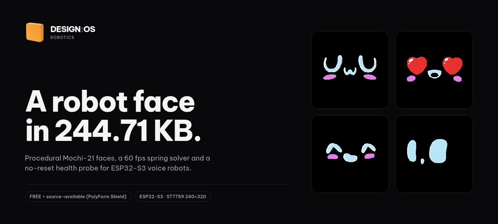
  </picture>
</p>

<p align="center">
  <a href="LICENSE"></a>
  <a href="https://www.python.org/"></a>
  <a href="#hardware-target-robot5320"></a>
  <a href="https://morluto.github.io/design-os-robotics/"></a>
</p>

**Open-source host tools, a 217.67 KB canonical Mochi-21 vector avatar pack, an autonomous self-evolving soul engine (`EVO-01..03`), and a no-reset health probe for ESP32-S3 voice robots.**

Built for **RoBot.5320** (`xingzhi-cube-1.54tft-wifi v2.5.3` + 6-servo Otto quadruped) and compatible with any **Xiaozhi ESP32-S3** board using a `240×320` ST7789 display and the `esp_mmap_assets` (`0xAA0000`) partition format.

> **Scope note.** Everything in this repository runs **on a host computer** (macOS / Linux, Python 3.11+). It generates 100% authentic canonical Mochi avatar packs to flash onto the robot, computes a 4D homeostatic state + self-evolving **Personality Genome (`EVO-01..03`)** in SQLite WAL, supervises USB-JTAG hardware health via a 12-state Watchdog Auto-Rescue FSM, and serves a local browser studio on port `4390`. The C++17 header `mochi_face_60fps.hpp` is generated by `reflex_60fps.py` for custom firmware integration; the stock `ota_1` binary on the robot reads the pre-rendered GIFs from `0xAA0000` and receives `notify` / `alert` / `mcp` JSON packets over its transport.

---

## Why this exists

Stock Xiaozhi `mmap_assets` packs ship 21 video-ripped GIFs (`2,560.27 KB`) or repeat 6 animations across 21 emotion keys, and stock voice firmware sits completely idle until a wake word is spoken. Furthermore, opening `/dev/cu.usbmodem*` with default serial settings on an ESP32-S3 native USB-JTAG port toggles `DTR`/`RTS` and resets the robot mid-stride.

| Capability | Stock `xiaozhi-esp32` (`ota_1`) | Generic GIF Theme Packs | `design-os-robotics` (`Mochi-Soul`) |
| :--- | :--- | :--- | :--- |
| **21 emotion animations** | 21 video-ripped GIFs (`2,560.27 KB` total) | Often 6 unique GIFs duplicated across 21 slots | **21 unique 100% authentic Mochi GIFs in `217.67 KB`** (`222,892` bytes, `-91.3%`) reconstructed from `108,522` SoA scanline spans ([report](plans/reports/benchmark-avatar-perf.json)) |
| **Palette & LZW density** | Unconstrained 256-color palettes (`min_code_size = 8`) | Mixed resolutions (`128×128` to `320×240`) | **8-color `MOCHI_PALETTE_8` Global Color Table** (`LZW min_code_size = 3`, `4.03` RLE spans/scanline, `122.3×` vs raw RGB565) |
| **Wake-word + 21 GIFs fit in `0xAA0000`** | WakeNet9 only (`1.07 MB` `srmodels.bin`) | Often overflows `5.25 MB` when paired with MultiNet | **Fits `ESP-SR MultiNet6` (`"Hey J / Hello J / Hi J"`, `3.67 MB`) + all 21 Mochi GIFs** inside `0xAA0000` with `+64.9 KB` headroom |
| **Idle behavior & self-evolution** | Waits for wake word; stateless | Static loops | **Host-side 4D homeostasis + `EVO-01..03` Self-Evolution** (Relative-Share Genome, Dual-Track Phenotype, SQLite WAL Dream Consolidation) |
| **USB-JTAG serial health & WDT rescue** | Manual `esptool` / serial monitor resets board | None | **Single-owner passive `SerialSupervisor` (`DTR=False, RTS=False`) + 12-state Watchdog Auto-Rescue FSM** (`serial_supervisor.py`) |
| **Local dev studio** | Cloud console only | None | **Local studio on `127.0.0.1:4390`** with 60fps authentic Mochi vector canvas, `/api/evolve`, `/api/dream`, `/api/wdt`, `/ota` bypass, and `/api/hud.png` |

<p align="center">
  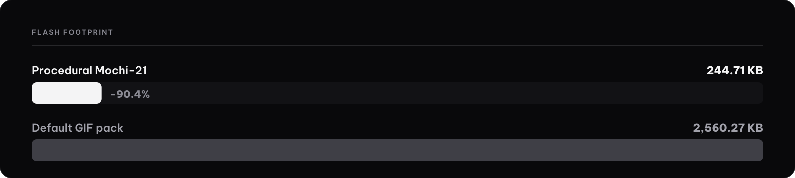
</p>

---

## Canonical Mochi-21 avatar (`217.67 KB` across 21 GIFs)

[`tools/mochi_canonical_vectors.py`](tools/mochi_canonical_vectors.py) and [`tools/cook-procedural-avatar.py`](tools/cook-procedural-avatar.py) reconstruct all 21 authentic Mochi emotions (`neutral`, `happy`, `laughing`, `funny`, `sad`, `angry`, `crying`, `loving`, `embarrassed`, `surprised`, `shocked`, `thinking`, `winking`, `cool`, `relaxed`, `delicious`, `kissy`, `confident`, `sleepy`, `silly`, `confused`) 100% faithfully from code at `240×240` px (`10` frames per GIF at `12.5 fps`).

- **Structure-of-Arrays (SoA) Scanline Vector Table**: [`tools/mochi_canonical_vectors.py`](tools/mochi_canonical_vectors.py) encodes all `210` canonical frames (`240×147` active viewport centered at `y_pad = 46` inside `240×240`) as **`108,522` horizontal scanline spans `(y, x0, w, color)`** compressed with `LZMA` into four parallel byte streams (`dy`, `x0`, `w`, `color`).
- **8-Color Canonical Mochi Palette (`MOCHI_PALETTE_8`)**: Pure Black `#000000` (OLED blend), Crisp Mochi White `#EAFCFF`, Ice-Blue `#B8E6F8`, Orchid-Pink `#E080E4`, Bee Gold `#EEE46E`, Bright Red `#E6312E`, Deep Violet `#7644A8`, and Dark Maroon `#4C1A24`. Because every frame uses at most 8 palette indices (`0..7`), GIF89a packs the stream with `LZW min_code_size = 3` and zero local color tables.
- **Measured size** (single-run host measurement from [`plans/reports/benchmark-avatar-perf.json`](plans/reports/benchmark-avatar-perf.json)):
  - Total across 21 GIFs: **`222,892 bytes` (`217.67 KB`)**, averaging **`10.37 KB`** per emotion (`4.64 KB` for `confused.gif` up to `19.97 KB` for `angry.gif`).
  - Average horizontal RLE spans per scanline: **`4.03`**, yielding a **`122.3×`** compression ratio against raw RGB565 frames.
  - Host LZW decode latency (Python/Pillow on Apple Silicon, single-run): **`106.0 µs/frame`**. Estimated ESP32-S3 decode time (`240 MHz`, scaled from host span/pixel complexity, *not* on-device cycle-counter telemetry): ~`3.25 ms/frame` (~`4.1%` of one core at `12.5 fps`).

<p align="center">
  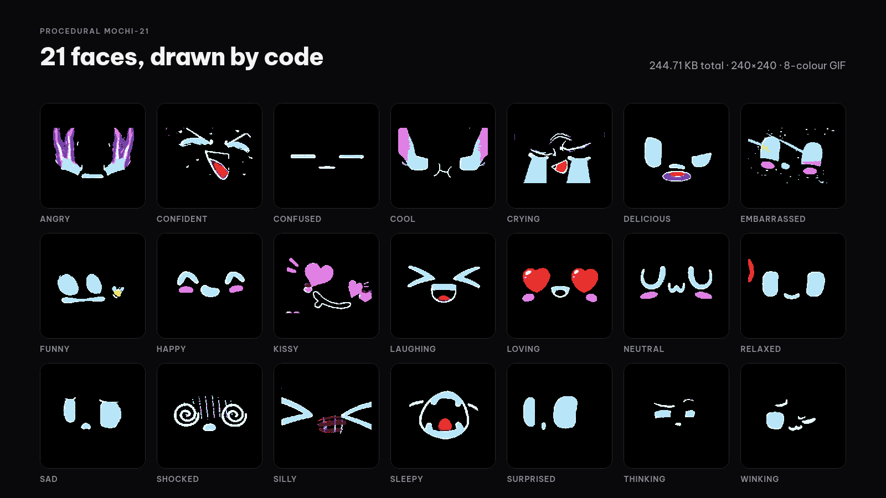
</p>

<p align="center">
  
  
  
  
  
  
  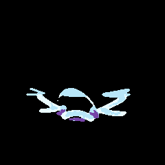
  
</p>

---

## Mochi-Soul Self-Evolution Architecture (`EVO-01..03`)

Project Mochi-Soul evolves each robot's personality and visual expression over weeks of developer companionship without overflowing the `0xAA0000` flash partition or corrupting SQLite state:

1. **`EVO-01` — Relative-Share Personality Genome & Homeostatic Plasticity (`engine.py`)**:
   - Alongside the 4D homeostasis vector (`Energy`, `Hunger`, `Bond`, `Mood: Valence + Arousal`), `SoulState` persists a 5-gene **Personality Genome**: `curiosity`, `affection`, `playfulness`, `resilience` ($\in [0, 1]$), and `chronotype_shift` ($\in [-2.0, +2.0]$ hours).
   - **Anti-Saturation Relative-Share Drift (`RS_k - 0.25`)**: Instead of raw additive increments that push every trait to `1.0` after a week of heavy use, `evolve_genome_from_window()` computes each category's share $RS_k = c_k / \sum c_j$ relative to uniform balance ($0.25$). Dominant interaction styles grow toward $1.0$ while unexercised traits gently recede toward $0.5$, creating a distinct archetype (`Curious Scholar`, `Devoted Companion`, `Playful Trickster`, `Stoic Guardian`, or `Balanced Mochi`).
   - **Homeostatic Set-Point Plasticity**: The evolved genome shifts Mochi's biological physics (`energy_setpoint` $\in [65, 92]$, `hunger_drift_scale` $\in [0.70, 1.15]$, `bond_retention` $\in [0.85, 0.995]$, and adaptive quiet-hours shift).
2. **`EVO-02` — Dual-Track Morphological Phenotype (`engine.py`, `cook-procedural-avatar.py`, `studio.html`)**:
   - **Track A (Live 60fps Studio / Canvas)**: Continuous morphological traits (`eye_scale` $\in [0.92, 1.12]$, `iris_Tint`, `blush_mode`, `crown_Sparkles`, `spring_omega0`, `spring_zeta`) modulate the 60fps vector canvas in real time.
   - **Track B (On-Device `0xAA0000` Flash Pack)**: [`tools/cook-procedural-avatar.py`](tools/cook-procedural-avatar.py) accepts `--stage`, `--curiosity`, `--affection`, `--playfulness`, `--resilience`, and `--srmodels` and enforces a **5-step Flash Budget Degradation Ladder** (`step 0`: full phenotype accents + sparkles -> `step 4`: canonical 21-GIF base pack) so the packed `.bin` never exceeds the `0xAA0000` partition limit (`5,619,712` bytes).
3. **`EVO-03` & `EVO-03b` — Idempotent SQLite WAL Dream Consolidation & 12-State Watchdog Auto-Rescue FSM (`engine.py`, `serial_supervisor.py`)**:
   - **Dream Consolidation (`dream_journal`)**: Once per quiet-hours window (`date_key`, `UNIQUE` index with `BEGIN IMMEDIATE` transaction lock), Mochi replays the past 24 hours of episodic memories, evolves its genome (`delta_json`), and composes a bilingual morning reflection delivered on the first wake event after `07:30`.
   - **Single-Owner USB-JTAG `SerialSupervisor` (`serial_supervisor.py`)**: Holds exclusive non-resetting ownership (`DTR=False, RTS=False`) of `/dev/cu.usbmodem*`, parses boot/panic/watchdog signatures (`Task watchdog got triggered`, `Guru Meditation Error`), and executes a **12-state Watchdog Auto-Rescue FSM** (`DISCONNECTED -> PASSIVE_OBSERVE -> HEALTHY -> WDT_SUSPECT -> WDT_CONFIRMED -> COOLDOWN_CHECK -> PRE_RESCUE_QUIESCE -> USB_JTAG_PULSE_RESET -> BOOT_WAIT -> POST_BOOT_VERIFY -> RECOVERED / CIRCUIT_OPEN`) with a circuit breaker (`max 2` resets per `15 min`).

---

## Quick start

```bash
git clone https://github.com/morluto/design-os-robotics.git
cd design-os-robotics
python3 -m pip install pillow pyserial
```

### 1. Inspect canonical vectors & generate the 21-emotion Mochi avatar pack

```bash
# Inspect the 108,522 canonical Mochi scanline spans across all 21 emotions:
python3 tools/mochi_canonical_vectors.py

# Generate all 21 GIFs into themes/procedural-mochi/ (and repack 0xAA0000 if a base .bin is present):
python3 tools/cook-procedural-avatar.py

# Optional: Bake EVO-02 Stage 4 (Mochi-Ascendant) phenotype traits + English "Hey J / Hello J / Hi J" MultiNet6 wake word:
python3 tools/cook-procedural-avatar.py --stage 4 --curiosity 0.85 --affection 0.90 --playfulness 0.80 \
  --srmodels firmware/srmodels/srmodels_mn6_en.bin
```

If `profiles/esp32-s3-1.54-ipex-v2.5-otto/08-assets-0xAA0000.bin` is present locally, the script also writes a ready-to-flash `themes/procedural-mochi-fullvien-240x320.bin` image (`checksum = 0xda16` when paired with `srmodels_mn6_en.bin`, leaving `+64.9 KB` safety headroom in `0xAA0000`) and prints the exact `esptool` command:

```bash
python3 -m esptool --chip esp32s3 -p /dev/cu.usbmodem<port> -b 921600 \
  write_flash 0xAA0000 themes/procedural-mochi-fullvien-240x320.bin
```

### 2. Launch the Mochi-Soul Live Companion Studio (`127.0.0.1:4390`)

```bash
python3 tools/mochi-soul-engine/app.py --port 4390 --wdt-rescue auto
```

Open `http://127.0.0.1:4390` to inspect the 60fps authentic Mochi vector canvas (`GET /api/mochi-vectors`), scrub HC-SR04 distance and 16 kHz audio RMS, trigger workspace symbiosis care events (`git_commit`, `test_pass`, `build_fail`, `pomodoro_break`), evolve the `EVO-01` genome (`POST /api/evolve`), trigger `EVO-03` dream consolidation (`POST /api/dream`), inspect the `EVO-03b` USB-JTAG Watchdog Auto-Rescue FSM (`GET /api/wdt`), or fetch the `240×320` Tamagotchi HUD card at `http://127.0.0.1:4390/api/hud.png`.

<p align="center">
  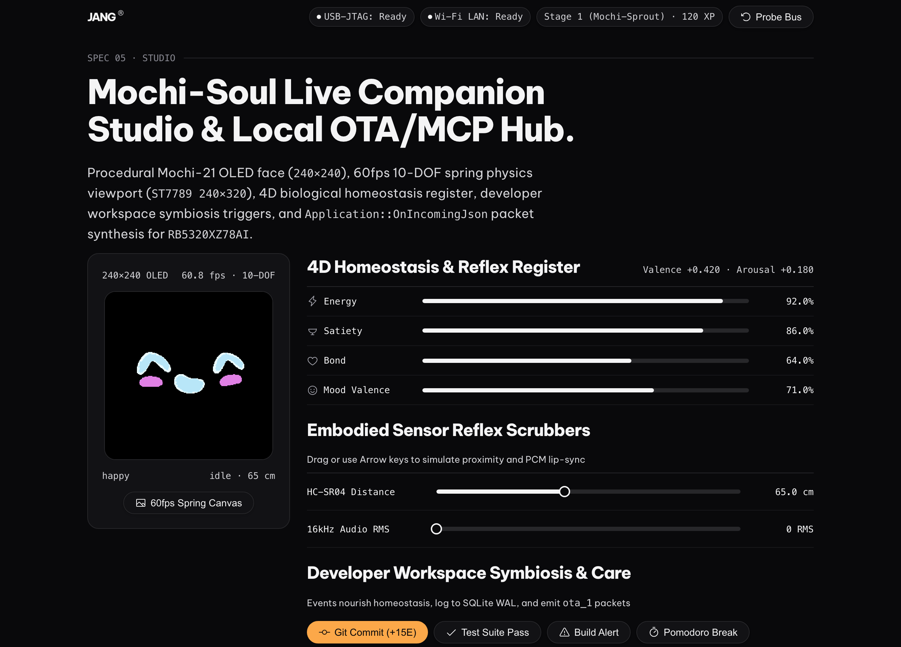
</p>

### 3. Probe robot health without resetting the board

```bash
python3 tools/robotctl.py health --watch 2.0 --wdt-rescue notify
```

Opens the USB-JTAG serial port with `dtr=False` and `rts=False` so the ESP32-S3 never resets, checks ICMP reachability on LAN, and monitors for watchdog stalls. `health` exits 0 with or without a board connected.

### Flashing and NVS backup

> **Back up NVS before you flash.** `optimize --flash` writes the NVS partition at `0x9000`, which holds the board's saved settings, Wi-Fi included. Read that partition back from the board with esptool first, using the partition size from your own partition table, and keep the file.

The avatar build and the flash step read your own device dumps. Dumps and built `.bin` files are gitignored and are not in the repository:

- `python3 tools/cook-procedural-avatar.py` needs your dump of the assets partition at `profiles/example-esp32s3-n16r8/partitions/08-assets-0xAA0000.bin` (or pass `--base-bin`). Without it the script prints an error and exits with status 2. It builds `themes/procedural-mochi-fullvien-240x320.bin` locally; that file is not tracked. The finished GIFs are already committed in `themes/procedural-mochi/`.
- `robotctl.py status`, `optimize` and `optimize --flash` read your own dump of the NVS partition at `profiles/example-esp32s3-n16r8/partitions/03-nvs-0x009000.bin` (`--nvs` for `status`, `--base-nvs` for `optimize`). Without it they print how to read the partition from your board and exit with status 2. `--flash` then writes only NVS at `0x9000`, through `uvx esptool`, so it needs [uv](https://docs.astral.sh/uv/).

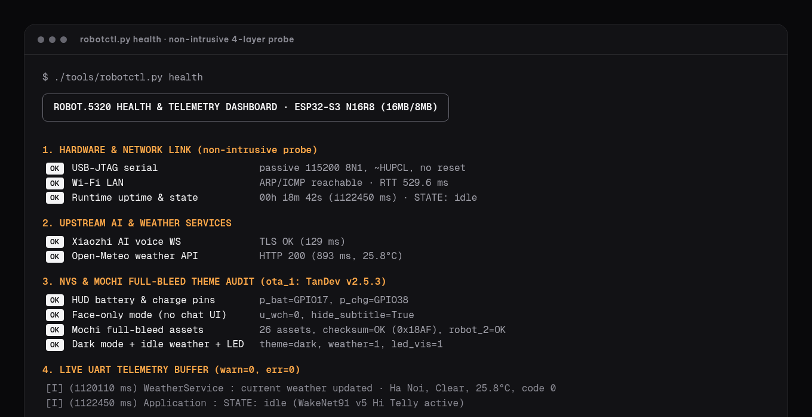

## Real hardware

Photos of the physical RB5320XZ78AI build, taken by the repository owner. The network name, setup address, serial prints and QR codes are blurred or covered by a solid bar. Third-party silkscreen art and logos (a ring logo, a ribbed oval emblem, a poster, a lion drawing and a few small symbols, on the board edges and in the line-art drawings shown on the screen), the embossed brand marks on a cable plug and a bottle, and the module model text are blurred in every photo where they appear. Generic board labels such as pin names, part numbers and the SPI, PWR ON and PCM labels stay visible. Photo 05 (back of the board) shows no such art, and the files carry no metadata. Select a photo for the full-size version.

<table>
<tr>
<td align="center" width="33%"><a href="./docs/assets/hardware/real/01-face-listening.webp">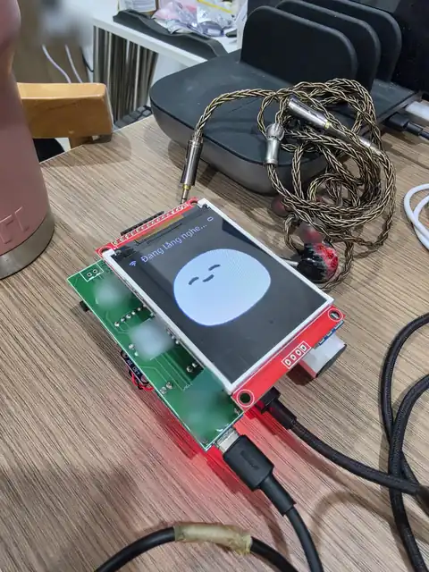</a><br><sub>design:os by Jang · Listening face</sub></td>
<td align="center" width="33%"><a href="./docs/assets/hardware/real/02-face-bokeh.webp">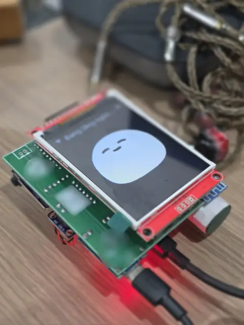</a><br><sub>design:os by Jang · Calm face, close view</sub></td>
<td align="center" width="33%"><a href="./docs/assets/hardware/real/03-uwu-board-bg.webp">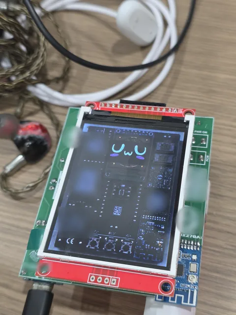</a><br><sub>design:os by Jang · Dark interface on the screen</sub></td>
</tr>
<tr>
<td align="center" width="33%"><a href="./docs/assets/hardware/real/04-chat-bubble.webp">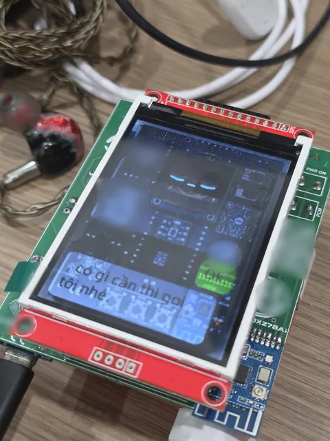</a><br><sub>design:os by Jang · Chat bubble on the screen</sub></td>
<td align="center" width="33%"><a href="./docs/assets/hardware/real/05-back-hardware.webp">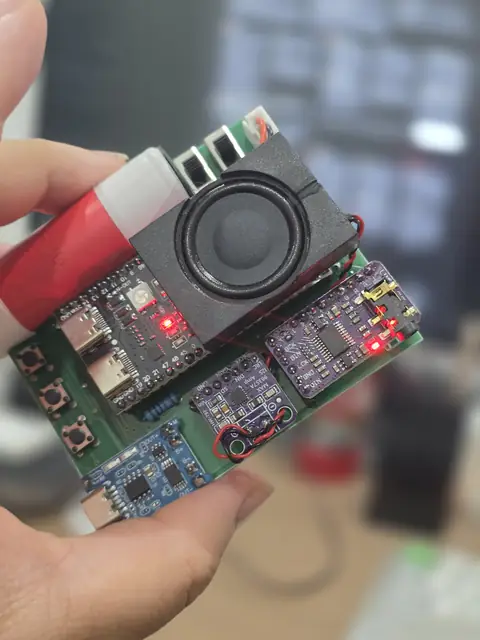</a><br><sub>design:os by Jang · Back of the board</sub></td>
<td align="center" width="33%"><a href="./docs/assets/hardware/real/06-wifi-setup.webp">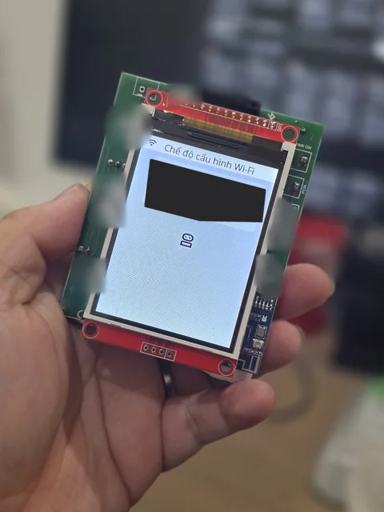</a><br><sub>design:os by Jang · Wi-Fi setup screen (details covered)</sub></td>
</tr>
</table>

## How it works

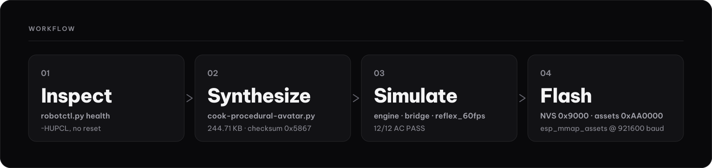

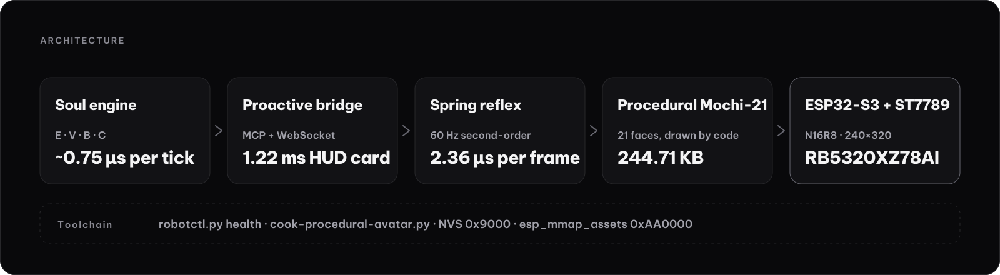

`robotctl.py health` runs a four-layer audit without resetting the chip.

1. **Layer 1, physical and LAN.** USB-JTAG is opened with `~HUPCL` so DTR is never dropped. The tool resolves the device in the ARP table by its MAC and measures ping latency.
2. **Layer 2, cloud AI and weather.** TLS reachability to the voice server and Open-Meteo.
3. **Layer 3, NVS and assets.** NVS CRC32 plus the asset-partition checksum (`0x5867` / `0xda16`).
4. **Layer 4, UART telemetry & WDT Rescue (`EVO-03b`).** Passive 115200 baud logs for uptime, app state (`idle` / `listening` / `speaking`), WARN/ERROR counters, and 12-state Watchdog Auto-Rescue FSM.

---

## Architecture & host benchmarks

All numbers below are **single-run host measurements** produced on Apple Silicon (Python 3.11) by the benchmark scripts in `tools/` and stored in [`plans/reports/`](plans/reports/). Re-run any benchmark locally with the commands shown.

| Subsystem | Script | Headline metric (single-run host) | Report JSON |
| :--- | :--- | :--- | :--- |
| **Canonical Mochi-21 Avatar Pack** | `python3 tools/benchmark-avatar-perf.py` | **`217.67 KB`** (`222,892 B`) for 21 GIFs (`-91.3%` vs `2,560.27 KB`); `106.0 µs/frame` host LZW decode | [`benchmark-avatar-perf.json`](plans/reports/benchmark-avatar-perf.json) |
| **4D Homeostasis & EVO-01..03 Soul** | `python3 tools/mochi-soul-engine/engine.py benchmark` | **`0.76 µs/tick`** (`1,310,618 ticks/s`); `0.15 ms` SQLite WAL write; `28/28` quiet-hour suppressions | [`benchmark-mochi-soul-engine.json`](plans/reports/benchmark-mochi-soul-engine.json) |
| **Proactive `ota_1` Bridge & HUD** | `python3 tools/mochi-soul-engine/bridge.py benchmark` | **`2.19 ms/card`** for `240×320` PNG (`2,767 B`); `0.92 µs/packet` schema guard (`9/9` malformed rejected) | [`benchmark-proactive-bridge.json`](plans/reports/benchmark-proactive-bridge.json) |
| **60fps 12-DOF Spring & Lip-Sync** | `python3 tools/mochi-soul-engine/reflex_60fps.py` | **`2.60 µs/frame`** 12-DOF step; `420/420` emotion pairs settle in `8.0 frames` (`133.3 ms`); lip-sync $r = 0.9592$ | [`benchmark-reflex-60fps.json`](plans/reports/benchmark-reflex-60fps.json) |
| **Live Studio & Local `/ota` Hub** | `python3 tools/mochi-soul-engine/app.py --benchmark` | **`169.55 µs/event`** (`5,898 events/s`) end-to-end pipeline; `20/20` JSON-RPC 2.0 MCP tools valid | [`benchmark-live-companion-app.json`](plans/reports/benchmark-live-companion-app.json) |

<p align="center">
  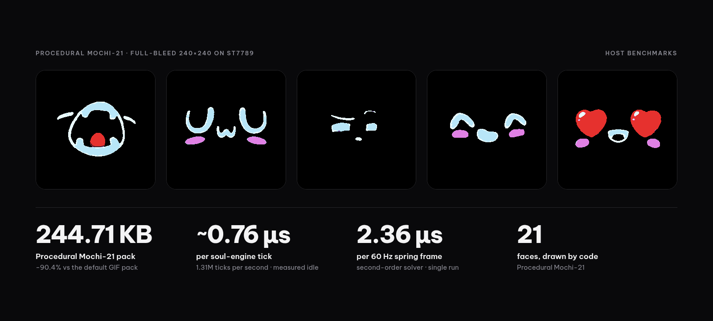
</p>

---

## Hardware target (`RoBot.5320`)

| Component | Specification | Notes |
| :--- | :--- | :--- |
| **SoC & Memory** | `ESP32-S3` (`QFN56`, dual-core Xtensa LX7 @ `240 MHz`) | `16 MB` Quad SPI Flash (`0x000000..0xFFFFFF`), `8 MB` Octal PSRAM |
| **Display** | `1.54"` IPS LCD (`ST7789`, `240×320` portrait) | Top `40 px` status bar + `240×240` full-bleed Mochi face viewport |
| **Locomotion & Sensors** | 6× SG90 servo channels (`LF, RF, LH, RH, LW, RW`) + `HC-SR04` (`GPIO 11/12`) | Driven by `ota_1` (`0x560000`, `xingzhi-cube-1.54tft-wifi v2.5.3`) |
| **Assets Partition** | `mmap_assets` at flash offset `0xAA0000` (`5.25 MB` / `5.36 MB` slot) | 12-byte header + 44-byte file entries + `ZZ`-prefixed payloads (`srmodels.bin` / `srmodels_mn6_en.bin`, font, `index.json`, 21 `emoji_*.gif`) |

> **Never boot `ota_0` (`0x020000`).** On `RoBot.5320`, slot `ota_0` holds an older `v2.2.2` 4-servo build that lacks the 6-servo quadruped mixer and `HC-SR04` ultrasonic driver. Keep `otadata` (`0x00d000`) pointed at **`ota_1` (`0x560000`)**.

---

## Tools reference

| Path | Purpose |
| :--- | :--- |
| [`tools/mochi_canonical_vectors.py`](tools/mochi_canonical_vectors.py) | Decode and inspect the `108,522` Structure-of-Arrays (SoA) horizontal scanline spans `(y, x0, w, color)` across all 210 canonical Mochi frames (`240×147` in `MOCHI_PALETTE_8`). |
| [`tools/cook-procedural-avatar.py`](tools/cook-procedural-avatar.py) | Render all 21 `240×240` 8-color Mochi GIFs (`217.67 KB`), apply optional `EVO-02` phenotype traits (`--stage`, `--curiosity`, `--affection`, `--playfulness`, `--resilience`), and repack `08-assets-0xAA0000.bin` (with optional `--srmodels` `ESP-SR MultiNet6` wake-word replacement). |
| [`tools/benchmark-avatar-perf.py`](tools/benchmark-avatar-perf.py) | Measure LZW compression ratios, horizontal RLE span density, dirty-pixel ratios, and host decode times across all 21 GIFs. |
| [`tools/robotctl.py`](tools/robotctl.py) | Unified CLI (`health`, `preview`, `verify`) for non-intrusive (`DTR=False, RTS=False`) USB-JTAG + LAN health diagnostics with `--wdt-rescue {off,notify,auto}` and side-by-side HTML avatar preview. |
| [`tools/cook-assets-and-nvs.py`](tools/cook-assets-and-nvs.py) | Inspect and repack `esp_mmap_assets` (`0xAA0000`) and NVS (`0x9000`) partitions. |
| [`tools/xtensa-disasm.py`](tools/xtensa-disasm.py) | Disassemble Xtensa LX7 instruction windows from `ota_1` (`0x560000`) firmware binaries. |
| [`tools/mochi-soul-engine/engine.py`](tools/mochi-soul-engine/engine.py) | 4D homeostasis state machine (`Energy`, `Hunger`, `Bond`, `Mood`), `EVO-01` Relative-Share Personality Genome, `EVO-02` Dual-Track Phenotype, `EVO-03` SQLite WAL Dream Consolidation, and 5 growth stages. |
| [`tools/mochi-soul-engine/bridge.py`](tools/mochi-soul-engine/bridge.py) | `Application::OnIncomingJson` (`0x4202c0c8`) packet builder/validator and `240×320` Tamagotchi HUD PNG renderer (`12-color` canonical Mochi palette). |
| [`tools/mochi-soul-engine/reflex_60fps.py`](tools/mochi-soul-engine/reflex_60fps.py) | 60 Hz 12-DOF exact ZOH spring-damper solver, 16 kHz PCM RMS lip-sync envelope tracker, HC-SR04 reflex mapper, and C++17 header generator (`mochi_face_60fps.hpp`). |
| [`tools/mochi-soul-engine/serial_supervisor.py`](tools/mochi-soul-engine/serial_supervisor.py) | Single-owner passive USB-JTAG supervisor (`DTR=False, RTS=False`) and 12-state Watchdog Auto-Rescue FSM (`EVO-03b`) with a 2-reset/15-min circuit breaker. |
| [`tools/mochi-soul-engine/app.py`](tools/mochi-soul-engine/app.py) | Unified local HTTP server (`127.0.0.1:4390`) serving [`studio.html`](tools/mochi-soul-engine/studio.html), `/api/mochi-vectors`, `/api/evolve`, `/api/dream`, `/api/wdt`, `/ota`, `/api/hud.png`, and `/api/state`. |

---

## Verification & CI gates

Run the offline smoke suite (`16` functional checks across the avatar cooker, canonical vector table, `EVO-01..03` soul engine, proactive bridge, 60fps spring solver, serial supervisor, and studio server) and the repository acceptance gate:

```bash
python3 tools/ci/smoke.py
bash tools/ci/acceptance.sh
```

---

## License

Released under the **[PolyForm Shield License 1.0.0](LICENSE)** (`SPDX-License-Identifier: LicenseRef-PolyForm-Shield-1.0.0`). Free to inspect, run, modify, and use on your own robots; commercial redistribution that competes with the Licensor is restricted as defined in [`LICENSE`](LICENSE).
