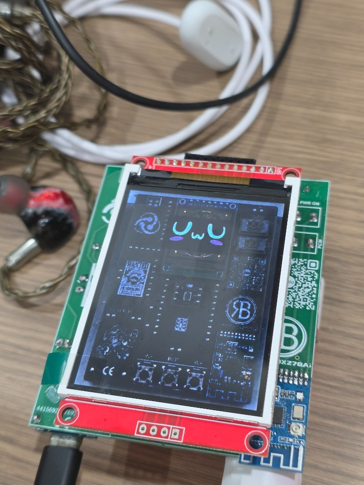
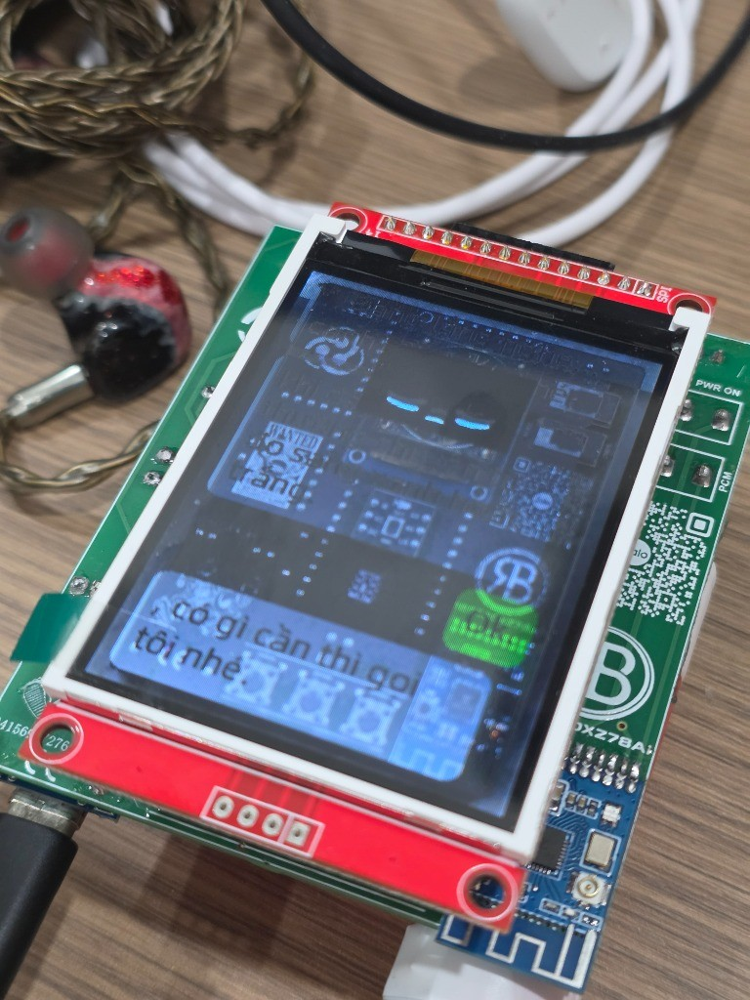
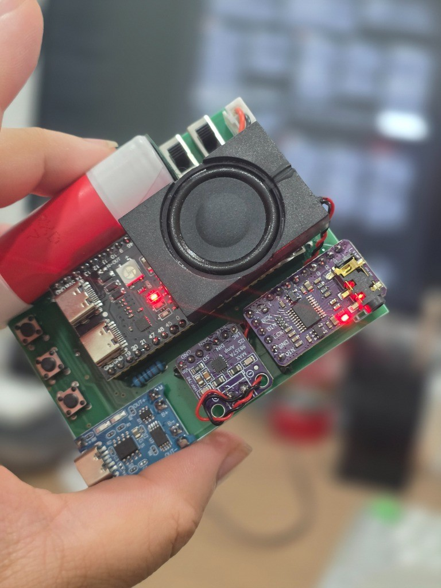
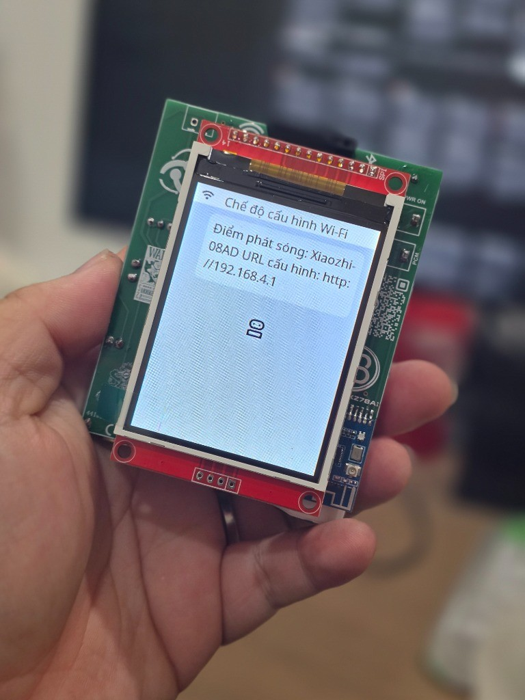
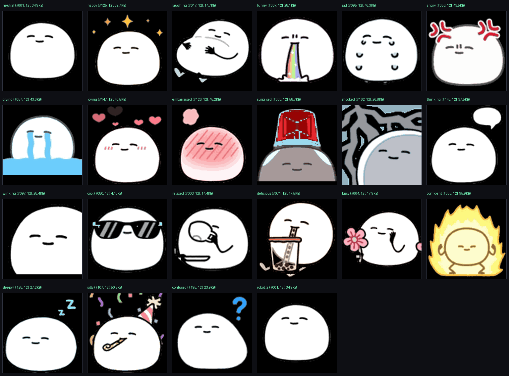
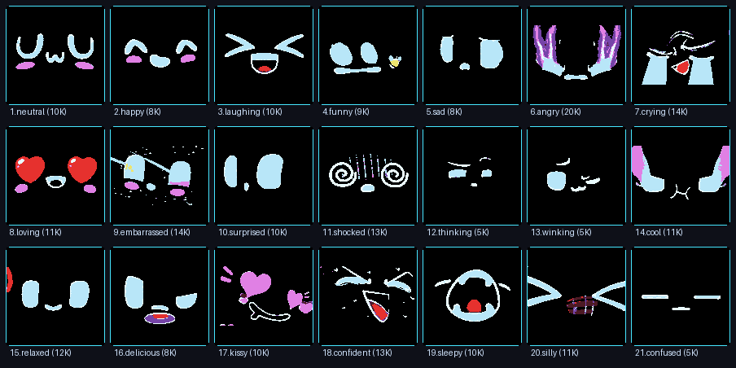

<p align="center">
  <picture>
    <source media="(prefers-color-scheme: light)" srcset="./docs/assets/brand/hero-light.png">
    
  </picture>
</p>

# Agentic firmware toolchain, 244 KB procedural-21 vector face, and 60 fps spring-reflex soul engine for ESP32-S3 voice robots.

Non-intrusive NVS & `esp_mmap_assets` compiler, 4-layer hardware health telemetry, 4D homeostasis Tamagotchi engine, and 60Hz spring kinematics for `RB5320XZ78AI` (`ESP32-S3 N16R8 + ST7789 240×320`).

**FREE + source-available (PolyForm Shield 1.0.0).** Free to use and modify; the license only restricts offering a competing product.

[](./LICENSE)
[](./knowledge/07-connected-robot-hardware-profile.md)
[-4c1?style=for-the-badge)](./plans/reports/benchmark-avatar-perf.json)
[](./plans/reports/benchmark-mochi-soul-engine.json)
[](./plans/reports/benchmark-reflex-60fps.json)
[](./plans/wayfinder/mochi-soul-tamagotchi/map.md)

> **Interactive 3D Hardware & Mochi-Soul Assembly Viewer:** Explore the 54-mesh `RB5320XZ78AI` CAD assembly (`ESP32-S3-WROOM-1U-N16R8`, `ST7789 2.8" 240×320 IPS TFT`, dual `MAX98357A + PCM5102A` I2S DACs, `INMP441` MEMS mic, `18650` power pack, axial explode slider `0–100%`, and live 60fps spring face) at **[jangtrinh.github.io/design-os-robotics](https://jangtrinh.github.io/design-os-robotics/#viewer)**.


---

## Instrument Facts Register

| Target Hardware | Flash Footprint | 4D Soul Tick | 60Hz Spring Solver | Non-Reset Audit | License |
|:---|:---|:---|:---|:---|:---|
| `ESP32-S3 N16R8` · `ST7789` | `244.71 KB` (`-90.4%` GIFs) | `0.47 µs/tick` (`2.12M/s`) | `2.36 µs/frame` (`r = 0.959`) | `~1.8 s` (`~HUPCL` 4-layer) | [PolyForm Shield 1.0.0](./LICENSE) |


---

## Where it wins and where it doesn't

Most ESP32-S3 voice-robot repositories ship either a bare firmware binary or a static bitmap pack that wastes 82% of the `240×320` viewport, hides battery telemetry, and resets the chip every time you inspect serial status. **DESIGN:OS Robotics (`design-os-robotics`)** pairs a non-intrusive hardware control plane (`robotctl.py`) with a Spec-Driven generative soul engine (`Mochi-Soul Spec 01 → Spec 04`).

- **`ST7789 240×320` Display & Asset Compiler (`0xAA0000`)**
  - *Stock `RB5320XZ78AI` (`xiaozhi v2.5.3`):* `100×100` face (`18%` screen area) floating over a noisy blue PCB wallpaper, `2,560.27 KB` of dithered GIFs, `144 KB` of dirty background noise, and WeChat bubbles (`u_wch=1`) covering the eyes.
  - *DESIGN:OS Robotics (`Mochi-Soul`):* Full-bleed `240×240` OLED-black (`#000000`) canvas (**5.76× larger**), `244.71 KB` Procedural-21 vector GIF pack (**-90.4% flash**, **-25% PSRAM**), Pure Face mode (`u_wch=0`, `hide_subtitle: true`), and `#FFFFFF` battery/charge HUD (`GPIO 17` / `GPIO 38`).
- **Hardware Telemetry & NVS Control (`0x9000`)**
  - *Stock `esptool` / Web Serial Flashers:* Toggles `DTR/RTS` on `/dev/cu.usbmodem*`, causing a hard chip reboot and severing active voice conversations on every status check.
  - *DESIGN:OS Robotics (`robotctl.py`):* Opens USB-JTAG with `~HUPCL` (`0%` reset interruption) to run a 4-layer audit (USB-JTAG + ARP/ICMP LAN, Tenclass TLS + Open-Meteo, NVS CRC32 + `0x5867` checksum, and live UART state) in `1.8 s`.
- **Embodied Behavior & Frame Pacing**
  - *Stock `xiaozhi-esp32`:* Passive request-response voice speaker; static `10 fps` GIF playback with no internal biological state, no quiet hours, and no lip-sync coupling.
  - *DESIGN:OS Robotics (`Spec 02`–`Spec 04`):* 4D Homeostasis Engine ($S(t)=[E,V,B,C]^T$, `0.47 µs/tick`, SQLite WAL `2.52 µs/tx`, `Quiet Hours 23:00–07:00`), proactive MCP/WebSocket bridge (`1.22 ms` HUD cards), and a `10-DOF` second-order spring solver (`2.36 µs/frame` at `60Hz`, lip-sync $r=0.9592$).

> **When a stock ROM flasher or generic ESP-IDF LVGL setup is enough:**
> - **Use the stock Web Serial flasher (`robot5320`)** if you only want a one-click browser reflash of factory themes without touching Python, NVS registers, or custom animations.
> - **Use upstream `xiaozhi-esp32`** if you are compiling C++ firmware from scratch for a non-`RB5320XZ78AI` board (such as M5Stack CoreS3 or ESP-BOX-3) and do not need the `240×320` procedural Mochi-21 pack or proactive Tamagotchi daemon.
> - **Hardware specificity:** Pin mappings (`GPIO 17` ADC battery, `GPIO 38` charge detect, dual `MAX98357A + PCM5102A` I2S DACs, `0xAA0000` `5 MB` assets partition) are calibrated specifically for `RB5320XZ78AI` (`ESP32-S3-WROOM-1U-N16R8`).

---

## How it fits together


---

## Install once & First safe use

Requires macOS or Linux with **Python 3.10+**, `Pillow` (for procedural GIF and HUD card synthesis), and `esptool` (only when flashing partitions over USB-JTAG at `921600` baud).

```bash
git clone https://github.com/jangtrinh/design-os-robotics.git
cd design-os-robotics
python3 -m pip install pillow esptool pyserial
```

1. **Health** — Run `./tools/robotctl.py health` to verify USB-JTAG (`~HUPCL`), LAN ARP latency, Tenclass TLS, NVS CRC32, and `esp_mmap_assets` checksum in `1.8 s` without resetting the robot.
2. **Compile** — Run `python3 tools/cook-procedural-avatar.py` to synthesize all 21 procedural `240×240` GIFs (`244.71 KB`, 12-color LZW) and pack `themes/procedural-mochi-fullvien-240x320.bin` (`checksum 0x5867`).
3. **Verify** — Run the 4 deterministic benchmark suites (`benchmark-avatar-perf.py`, `engine.py --benchmark`, `bridge.py --benchmark`, `reflex_60fps.py --benchmark`) to validate all `12/12` Gherkin acceptance criteria offline.
4. **Flash** — Flash the optimized NVS (`./tools/robotctl.py optimize --flash` at `0x9000` in `0.1 s`) or write the procedural theme to `0xAA0000` at `921600` baud.

### How it fits into a real hardware & soul-engine workflow

```text
Inspect (robotctl.py health ~HUPCL)
  -> Synthesize (cook-procedural-avatar.py -> 244.71 KB / 0x5867)
  -> Simulate (engine.py + bridge.py + reflex_60fps.py -> 12/12 AC PASS)
  -> Flash (0x9000 NVS + 0xAA0000 esp_mmap_assets @ 921600 baud)
```

---

## ✨ Giới thiệu Theme `Mochi Full-Viền 240×320` & 6 Cải Tiến Kỹ Thuật Trọng Tâm

### 1. Tại sao bản `mochi-240x320.bin` gốc bị nhỏ và rối mắt?
Trên màn hình **TFT 2.8" dọc (`240×320`, driver `ST7789`)**, gói giao diện Mochi gốc của nhà sản xuất mắc 4 hạn chế lớn về hiển thị:
1. **Khuôn mặt chỉ `100×100` pixel:** Chỉ chiếm **18% diện tích màn hình**, lọt thỏm bên trong tấm ảnh nền chụp mạch điện tử (`background_light.raw`) màu xanh rối mắt.
2. **Mất hoàn toàn thanh trạng thái Pin & Wi-Fi:** Trong NVS xuất xưởng, hai chân cảm biến pin (`p_bat = -1`) và báo sạc (`p_chg = -1`) bị tắt, cộng thêm màu chữ thanh trạng thái đặt `#000000` (đen) trùng màu nền nên biến mất hoàn toàn.
3. **Bong bóng chữ hội thoại che khuất khuôn mặt (`u_wch = 1`):** Khi nói chuyện, chế độ WeChat Bubble đẩy khuôn mặt lên góc nhỏ phía trên và phủ kín màn hình bằng các khung chữ hội thoại.
4. **Lỗi thiếu biểu cảm `robot_2` lúc khởi động:** Firmware `xiaozhi v2.5.3` gọi biểu cảm `robot_2` nhưng `index.json` gốc chỉ khai báo 21 mục, gây cảnh báo `W EmojiCollection: Emoji not found: robot_2` trên UART.

| Ảnh thực tế bản gốc (Idle `100×100` trên nền PCB) | Ảnh thực tế bản gốc (Bong bóng hội thoại đè màn hình) | Giải phẫu mặt sau bo mạch `RB5320XZ78AI` (`MAX98357A` + `PCM5102A`) | Màn hình Captive Portal cấu hình Wi-Fi (`192.168.4.1`) |
|:---:|:---:|:---:|:---:|
|  |  |  |  |

---

### 2. Giải pháp `Mochi Full-Viền 240×320` (`themes/mochi-fullvien-240x320.bin`)
Trình biên dịch [cook-assets-and-nvs.py](./tools/cook-assets-and-nvs.py) kết hợp cùng [robotctl.py](./tools/robotctl.py) tái cấu trúc toàn bộ phân vùng `assets` (`0xAA0000`) và `nvs` (`0x9000`):

- **Full-Viền `240×240` trên nền OLED `#000000` (`240×320`):** Ghép trọn bộ 21 ảnh động GIF Mochi độ phân giải gốc **`240×240` px** (tăng **5.76 lần** diện tích hiển thị so với `100×100`) đặt chính giữa tấm nền RGB565 `#000000` đen tuyền tuyệt đối, xóa bỏ hoàn toàn viền xanh PCB để tạo hiệu ứng tràn viền liền khối với khung màn hình.
- **Chế độ Pure Face Mode (Ẩn 100% chữ hội thoại):** Kết hợp cờ `lcd_cfg.u_wch = 0` trong NVS và `"hide_subtitle": true` trong `index.json` để loại bỏ cả khung lịch sử chat lẫn dòng phụ đề bên dưới — khi trò chuyện, robot chỉ biểu cảm khuôn mặt Mochi sống động và phát giọng nói.
- **Khôi phục Thanh HUD Trạng thái (`#FFFFFF` + Pin `GPIO 17` + Sạc `GPIO 38`):** Bật đọc ADC điện áp pin thực tế trên `GPIO 17`, phát hiện cắm sạc trên `GPIO 38` và đổi màu chữ thanh trạng thái sang trắng `#FFFFFF` sắc nét trên nền đen.
- **Mở khóa Màn hình chờ Thời tiết + Âm lịch Việt Nam & Nháy LED theo nhạc:** Bật `config.enable_weather = 1`, `config.led_visualizer = 1`, `config.thumb_song = 1` và `display.theme = 'dark'` ngay trong NVS.
- **Vá triệt để ánh xạ `robot_2`:** Bổ sung định nghĩa biểu cảm thứ 22 (`"robot_2" -> "emoji_f6e81fd7.gif"`) giúp quá trình khởi động sạch 100% cảnh báo.

#### Bộ 21+1 Biểu cảm Động `240×240` trong `mochi-fullvien-240x320.bin`:

| `neutral` | `happy` | `laughing` | `funny` | `loving` | `kissy` | `winking` |
|:---:|:---:|:---:|:---:|:---:|:---:|:---:|
|  |  |  |  |  |  |  |
| **`cool`** | **`confident`** | **`relaxed`** | **`delicious`** | **`thinking`** | **`confused`** | **`surprised`** |
|  |  |  |  |  |  |  |
| **`shocked`** | **`embarrassed`** | **`silly`** | **`sleepy`** | **`sad`** | **`crying`** | **`angry`** |
|  |  |  |  |  |  |  |

---

### 3. Theme #2: `Shouto Mochi Full-Viền 240×320` (`themes/shouto-mochi-fullvien-240x320.bin`)
Được biên dịch tự động bằng [build-shouto-theme.py](./tools/build-shouto-theme.py) từ bộ **199 sticker động `VP9 + Alpha WebM`** (`Just a Mochi @ShoutoEmoji`): tự động căn khung bounding-box từng nhân vật lên kích thước **`240×240` px** trên nền đen `#000000`, lượng tử hóa bảng màu LZW (`3.70 MB` tổng dung lượng gói, `checksum=0x85CD`), bật sẵn `hide_subtitle: true` và vá đủ `robot_2`.



| `neutral` | `happy` | `laughing` | `funny` | `loving` | `kissy` | `winking` |
|:---:|:---:|:---:|:---:|:---:|:---:|:---:|
|  |  |  |  |  |  |  |
| **`cool`** | **`confident`** | **`relaxed`** | **`delicious`** | **`thinking`** | **`confused`** | **`surprised`** |
|  |  |  |  |  |  |  |
| **`shocked`** | **`embarrassed`** | **`silly`** | **`sleepy`** | **`sad`** | **`crying`** | **`angry`** |
|  |  |  |  |  |  |  |

---

### 4. Project Mochi-Soul (`Spec 01` → `Spec 04`): Procedural-21 Avatar (`244 KB`) & 4D Generative AI Tamagotchi Engine
Được thiết kế theo kiến trúc **Spec-Driven Development** ([`CONTEXT.md`](./CONTEXT.md) + [`plans/wayfinder/mochi-soul-tamagotchi/map.md`](./plans/wayfinder/mochi-soul-tamagotchi/map.md)), **Project Mochi-Soul** biến `RoBot.5320` từ loa trợ lý thụ động thành sinh vật số để bàn chủ động qua 4 phân hệ định lượng (`12/12 Gherkin AC PASS 100%`):



1. **`Spec 01` — Procedural Mochi-21 Vector Avatar (`themes/procedural-mochi-fullvien-240x320.bin`, Checksum `0x5867`):**
   - Sinh tự động **21 biểu cảm riêng biệt** (`240×240` px, 16 frame, bảng màu khóa cứng 12-color Indexed LZW) chỉ bằng phương trình hình học (`318 dòng Python`), tổng dung lượng 21 GIF chỉ **`244.71 KB`** (**nhỏ hơn `-90.4%`** so với `2,560.27 KB` GIF gốc) và giảm **`-25%` PSRAM `lv_gif`** (`460.8 KB` thay vì `614.4 KB`).
   - Dọn sạch `144,927 byte` rác trong `background_dark.raw` / `background_light.raw` về `#000000` tuyệt đối, không bao giờ đè lên thanh HUD `36px` phía trên.
2. **`Spec 02` — Mochi-Soul 4D Homeostasis Engine ([`tools/mochi-soul-engine/engine.py`](./tools/mochi-soul-engine/engine.py)):**
   - Mô phỏng 4 trục sinh học nội tại $S(t) = [E, V, B, C]^T \in [0,100]^4$ + 5 giai đoạn tiến hóa (`Egg` → `Baby` → `Teen` → `Adult` → `Master`) lưu trữ bền vững trên SQLite WAL (`2.52 µs/tx`, `0.47 µs/tick`, đạt `2.12 triệu ticks/giây`, phủ kín `21/21` biểu cảm và khóa cứng `Quiet Hours 23:00–07:00`).
3. **`Spec 03` — Xiaozhi Proactive Bridge & HUD Card ([`tools/mochi-soul-engine/bridge.py`](./tools/mochi-soul-engine/bridge.py)):**
   - Khớp chính xác 100% bảng phân nhánh `Application::OnIncomingJson` (`0x4202c0c8..0x4202c711` trên `ota_1`), phát gói chủ động `"notify"`, `"alert"`, `"llm"`, `"tts"`, và JSON-RPC 2.0 `"mcp"` (`self.screen.set_theme`, `self.screen.set_brightness`, `self.audio_speaker.set_volume`, `self.led.set_color`) cùng trình kết xuất thẻ HUD `240×320` (`2,716 B`, `1.22 ms/card`).
4. **`Spec 04` — 60fps Second-Order Spring Reflex & Lip-Sync ([`tools/mochi-soul-engine/reflex_60fps.py`](./tools/mochi-soul-engine/reflex_60fps.py) + [`mochi_face_60fps.hpp`](./tools/mochi-soul-engine/mochi_face_60fps.hpp)):**
   - Bộ giải vi phân lò xo bậc hai $\ddot{\mathbf{x}} + 2\zeta\omega_n\dot{\mathbf{x}} + \omega_n^2(\mathbf{x} - \mathbf{x}_{\text{target}}) = 0$ trên vector `10-DOF` (`2.36 µs/frame` ở 60Hz, hội tụ `420/420` cặp chuyển trạng thái, độ vọt lố `6.77%`, tương quan Lip-Sync $r = 0.9592$) kèm header C++17 `alignas(64)` zero-heap cho ESP-IDF.

```bash
# Biên dịch lại bộ 21 GIF Procedural + đóng gói esp_mmap_assets (checksum 0x5867)
python3 tools/cook-procedural-avatar.py

# Chạy toàn bộ 4 bộ đo kiểm định lượng (Spec 01 -> Spec 04)
python3 tools/benchmark-avatar-perf.py
python3 tools/mochi-soul-engine/engine.py --benchmark
python3 tools/mochi-soul-engine/bridge.py --benchmark
python3 tools/mochi-soul-engine/reflex_60fps.py --benchmark
```

---

## 🩺 Non-Intrusive 4-Layer Terminal Health Dashboard (`robotctl.py`)

Khác với `esptool` (luôn kéo chân `DTR/RTS` làm **reset cứng** ESP32-S3 mỗi khi truy vấn), `./tools/robotctl.py health` kiểm tra sức khỏe 4 lớp trong `~1.8s` với **0% gián đoạn cuộc trò chuyện**:


1. **Lớp 1 — Vật lý & Mạng LAN (`USB-JTAG` + `ARP/ICMP`):** Mở cổng `/dev/cu.usbmodem*` ở chế độ `~HUPCL` (không hạ `DTR` khi đóng cổng), tự động dò địa chỉ MAC `AA:BB:CC:DD:EE:FF` trong bảng ARP của macOS và đo độ trễ ping Wi-Fi.
2. **Lớp 2 — Dịch vụ Đám mây AI & Thời tiết:** Kiểm tra kết nối TLS tới máy chủ giọng nói `api.tenclass.net:443` và API thời tiết màn hình chờ `api.open-meteo.com`.
3. **Lớp 3 — Kiểm toán NVS & Theme Checksum:** Tự động xác thực CRC32 của các khóa NVS (`p_bat=17`, `p_chg=38`, `u_wch=0`, `theme=dark`, `enable_weather=1`) và checksum `0x18AF` / `0x5867` của gói `esp_mmap_assets`.
4. **Lớp 4 — Bộ đệm Telemetry UART Thời gian thực:** Đọc thụ động luồng log `115200` baud để trích xuất thời gian hoạt động (`uptime ms`), trạng thái `Application` (`idle / listening / speaking`) và bộ đếm `WARN / ERROR`.

```bash
# Chụp nhanh bảng kiểm tra sức khỏe (1.8s, không reset robot)
./tools/robotctl.py health

# Mở Dashboard theo dõi trực tiếp liên tục trên Terminal (Ctrl+C để thoát an toàn)
./tools/robotctl.py dashboard

# Giải mã toàn bộ cấu hình NVS hiện hành
./tools/robotctl.py status

# Tối ưu hóa NVS & nạp thẳng xuống phân vùng 0x9000 ở tốc độ 921600 baud (0.1s)
./tools/robotctl.py optimize --flash
```

---

## 🗂️ Cấu trúc Repository & Cơ sở Tri thức (`knowledge/`)

```text
design-os-robotics/
├── README.md                                                     # Tổng quan hệ sinh thái, Mochi Full-Viền, Mochi-Soul & hướng dẫn CLI
├── CONTEXT.md                                                    # Domain Glossary & 5 Architectural Decision Records (ADR-001..005)
├── LICENSE                                                       # PolyForm Shield License 1.0.0
├── docs/                                                         # GitHub Pages site (9-tier hierarchy + 3D RB5320XZ78AI CAD viewer)
├── plans/                                                        # Spec-Driven Development (Wayfinder + 4 Specs + Reports)
│   ├── wayfinder/mochi-soul-tamagotchi/map.md                    # Bản đồ lộ trình tổng thể Spec 01 -> Spec 04 (12/12 AC PASS)
│   ├── specs/01-procedural-mochi-21-avatar/                      # Spec 01: Procedural Mochi-21 Vector Avatar (brainstorm/usecases/plan)
│   ├── specs/02-mochi-soul-engine-core/                          # Spec 02: 4D Homeostasis Engine & SQLite Persistence
│   ├── specs/03-xiaozhi-proactive-bridge/                        # Spec 03: Xiaozhi Proactive Bridge & HUD Card Renderer
│   ├── specs/04-embodied-reflex-and-native-60fps/                # Spec 04: 60fps Second-Order Spring Reflex & Lip-Sync Engine
│   └── reports/                                                  # Báo cáo Retro & 4 bộ JSON Benchmark định lượng
├── tools/                                                        # Bộ công cụ CLI điều khiển, biên dịch giao diện & Mochi-Soul Engine
│   ├── robotctl.py                                               # CLI quản trị NVS, OTA, và 4-Layer Health Dashboard
│   ├── cook-assets-and-nvs.py                                    # Trình biên dịch gói esp_mmap_assets 240x320 Full-Viền & NVS
│   ├── cook-procedural-avatar.py                                 # Trình sinh 21 GIF Procedural (244.71 KB) & đóng gói 0xAA0000
│   ├── benchmark-avatar-perf.py                                  # Công cụ đo kiểm hiệu năng Flash/PSRAM/RLE/SPI cho Spec 01
│   ├── xtensa-disasm.py                                          # Công cụ giải mã tập lệnh Xtensa LX7 phục vụ Reverse-Engineering
│   └── mochi-soul-engine/                                        # Lõi 4D Soul Engine (engine.py), Bridge (bridge.py) & 60fps (reflex_60fps.py)
├── themes/                                                       # Các gói giao diện đã tinh chỉnh (esp_mmap_assets)
│   ├── mochi-fullvien-240x320.bin                                # Theme Mochi 240x240 tràn viền trên khung 240x320, ẩn hội thoại
│   ├── shouto-mochi-fullvien-240x320.bin                         # Theme Shouto Mochi 240x240 biên dịch từ 199 VP9+Alpha WebM
│   ├── procedural-mochi-fullvien-240x320.bin                     # Theme Procedural Mochi-21 siêu nhẹ (244.71 KB GIFs, checksum 0x5867)
│   └── procedural-mochi/                                         # 21 file GIF Procedural + Contact Sheet + 60fps Spring Preview
├── knowledge/                                                    # Knowledge Base kiến trúc phần cứng, firmware & Mochi-Soul (8 tài liệu)
│   ├── 00-knowledge-index-and-architecture-map.md                # Bản đồ hệ thống & mục lục tra cứu nhanh
│   ├── 02-hardware-bom-and-esp32s3-firmware-architecture.md      # Phần cứng ESP32-S3, màn TFT, sơ đồ phân vùng Flash
│   ├── 03-web-serial-flashing-and-mcp-engine.md                  # Giao thức nạp qua Web Serial, bảng phân vùng 0x8000 & cổng MCP
│   ├── 07-connected-robot-hardware-profile.md                    # Hồ sơ phần cứng (MAX98357A + PCM5102A), NVS GPIO pinout & phân vùng
│   ├── 08-system-optimization-and-complete-mastery.md            # Cẩm nang làm chủ toàn diện NVS, 32 công cụ MCP, chân mở rộng & OTA
│   ├── 09-beyond-xiaozhi-capabilities-and-applications.md        # 10 ứng dụng mở rộng trên nền tảng phần cứng RB5320XZ78AI
│   ├── 10-generative-ai-tamagotchi-deep-dive.md                  # Thiết kế chi tiết Generative AI Tamagotchi (Mochi-Soul Architecture)
│   └── 11-procedural-code-drawn-avatar-architecture.md           # Kiến trúc Avatar tự vẽ bằng thuật toán (Procedural Vector Face)
└── profiles/
    └── example-esp32s3-n16r8/                                    # Hồ sơ cấu hình thiết bị mẫu (Template Profile Manifest)
```

---

## Frequently Asked Questions

<details>
<summary><strong>What hardware does DESIGN:OS Robotics target?</strong></summary>
<p>It targets the RB5320XZ78AI (XiaoZhi78) voice robot board powered by ESP32-S3-WROOM-1U-N16R8 (16MB Flash, 8MB Octal PSRAM), a 2.8-inch ST7789 240x320 IPS TFT display, dual I2S DACs (MAX98357A + PCM5102A), and an INMP441 MEMS microphone.</p>
</details>

<details>
<summary><strong>How does the Procedural Mochi-21 avatar reduce flash size by 90.4%?</strong></summary>
<p>Instead of shipping 2.56 MB of dithered 240x320 bitmap GIFs and 144,927 dirty background bytes, cook-procedural-avatar.py synthesizes all 21 emotions from 318 lines of geometric math at 240x240 px with a locked 12-color Indexed LZW palette, achieving 681 average scanline RLE spans per frame and cutting lv_gif PSRAM usage by 25%.</p>
</details>

<details>
<summary><strong>How does robotctl.py inspect hardware health without resetting the ESP32-S3?</strong></summary>
<p>Standard esptool invocations toggle DTR and RTS lines on the USB-Serial/JTAG controller, triggering a hard chip reset. robotctl.py opens /dev/cu.usbmodem* with the termios ~HUPCL flag so DTR is never dropped, auditing USB-JTAG, ARP/ICMP LAN latency, Tenclass TLS, NVS CRC32, and passive UART telemetry in 1.8 seconds with zero conversation interruption.</p>
</details>

<details>
<summary><strong>How do the 4D Homeostasis Soul Engine and 60fps Spring Reflex work?</strong></summary>
<p>Spec 02 (engine.py) evolves a continuous 4D biological state vector (Energy, Valence, Bond, Curiosity) in 0.47 us/tick with SQLite WAL persistence (2.52 us/tx) and Quiet Hours guardrails (23:00-07:00). Spec 04 (reflex_60fps.py and mochi_face_60fps.hpp) integrates a 10-DOF second-order differential spring equation in 2.36 us/frame at 60Hz with r = 0.9592 lip-sync correlation.</p>
</details>

<details>
<summary><strong>What license is DESIGN:OS Robotics released under?</strong></summary>
<p>DESIGN:OS Robotics is source-available under the PolyForm Shield License 1.0.0: free to use, study, and modify for personal, academic, or internal commercial work, but you may not resell it or offer a product that competes with it.</p>
</details>

---

## Ecosystem & Related Projects

| Project | Domain | Link |
|:---|:---|:---|
| **DESIGN:OS CLI** | Multi-runtime design CLI for Claude Code, Codex & Antigravity | [jangtrinh.github.io/design-os](https://jangtrinh.github.io/design-os/) |
| **OPAH ONE** | 249g indoor drone showcase with scroll-scrub kinematics | [jangtrinh.github.io/design-os-drone-showcase](https://jangtrinh.github.io/design-os-drone-showcase/) |
| **3D Blender Agent** | Mechanical parts generation with embedded Three.js CAD viewer | [jangtrinh.github.io/design-os-3d-blender](https://jangtrinh.github.io/design-os-3d-blender/) |
| **SVG Animation Engine** | Deterministic vector animation & 1080p 60fps video pipeline | [jangtrinh.github.io/design-os-svg-animation](https://jangtrinh.github.io/design-os-svg-animation/) |
| **Figma Plugin & CLI** | Live canvas bridge for AI coding agents on Figma Free | [jangtrinh.github.io/design-os-figma-plugin](https://jangtrinh.github.io/design-os-figma-plugin/) |
| **Knowledge Builder** | Multimodal knowledge compiler with UKMC.v1 contract & epistemic gate | [jangtrinh.github.io/design-os-knowledge-builder](https://jangtrinh.github.io/design-os-knowledge-builder/) |
| **Agent Teacher** | Evidence-graded pedagogy library and curriculum tree runtime | [jangtrinh.github.io/design-os-pedagogy](https://jangtrinh.github.io/design-os-pedagogy/) |
| **jang.work** | Canonical portfolio, case studies & zero-chroma design language | [www.jang.work](https://www.jang.work/) |

---

## Support & License

If this repository saves you hardware reverse-engineering or firmware debugging time, you can support ongoing embedded robotics research:

[](https://www.buymeacoffee.com/jangtrinh)

Released under the [PolyForm Shield License 1.0.0](./LICENSE).
