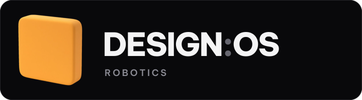
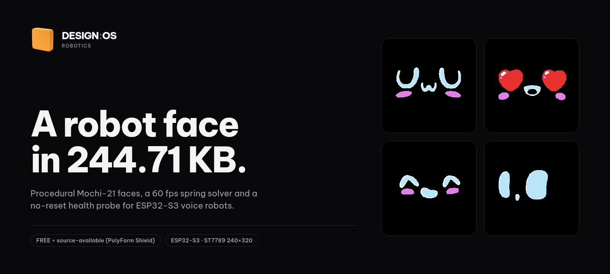
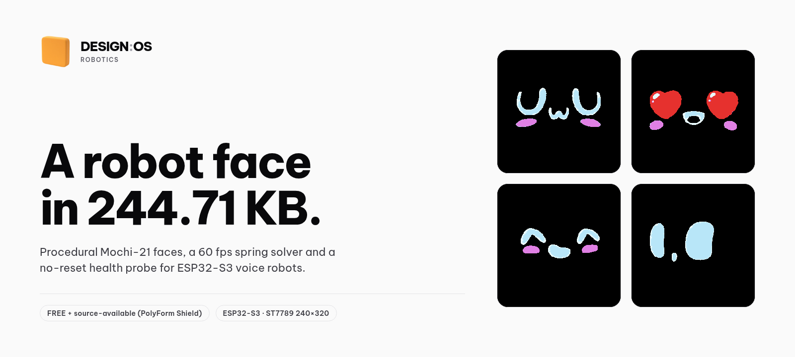
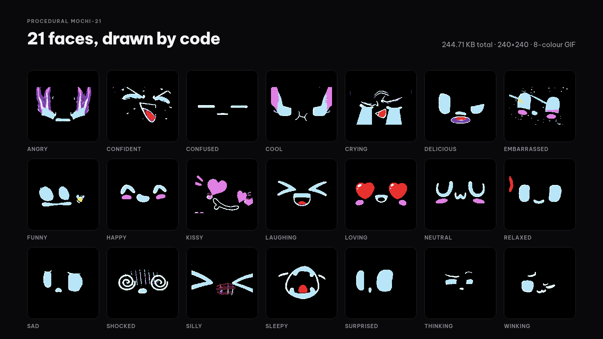
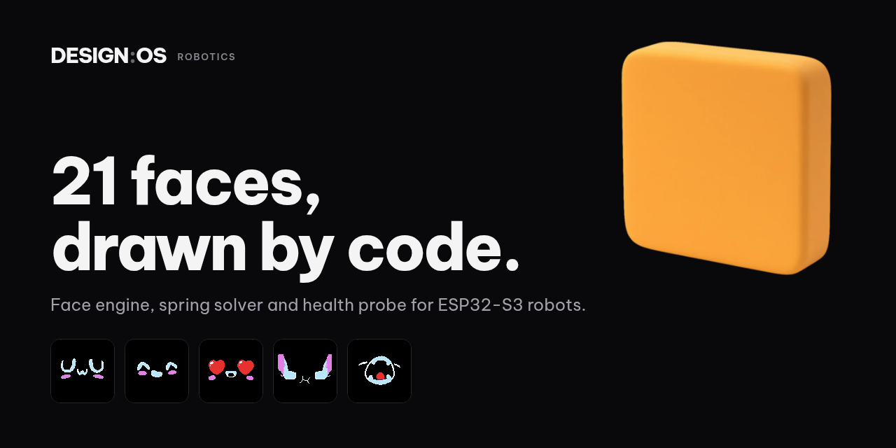
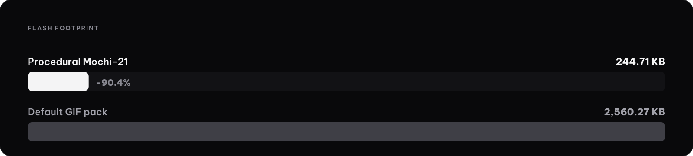
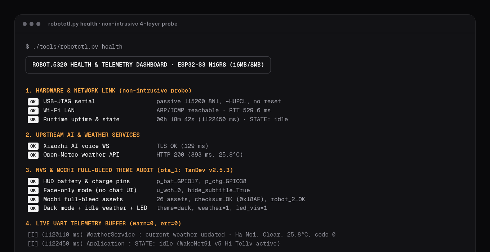
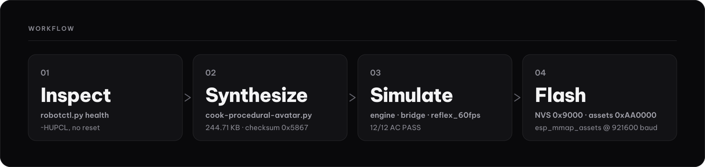

# Art direction

How to make assets for design-os-robotics that look like they belong here. It covers the site, the README, social images, promo images and motion. If a rule here
conflicts with a one-off idea, the rule wins. If a rule is wrong, change this file in a PR first.

The source of truth for colour, type and spacing is [`docs/assets/site.css`](./assets/site.css). If this file and `site.css` disagree, `site.css` is right and this file has a bug.

Every asset carries the same alt text and caption: `design:os by Jang`.



## 1. Principles

1. **Dark, flat, one accent.** Near-black canvas, zinc greys, a single orange. No gradients, no glow, no drop shadows on art. The one exception is the shaded block mark;
   its single list of files is the table in section 4 ("Shaded-mark exception").
2. **Real or absent.** A number, a face, a terminal line or a board view is either real output from this repository or it is not shown.
3. **Chunky and simple.** Big shapes, few of them, rough rather than polished. If a detail disappears at 64 px, remove it.
4. **Silent and quiet.** No sound by default, no loops that flash, no decorative motion.

## 2. Colour

All values are the tokens in `docs/assets/site.css`, plus the light canvas row. Use the hex, not an eyeballed neighbour.

| Role | Token | Hex | Use |
|:---|:---|:---|:---|
| Canvas | `--c-canvas`, `--c-gray-100` | `#09090b` | Page and image background |
| Surface | `--c-gray-200`, `--c-preview-bg` | `#121215` | Cards, tiles, terminal frames |
| Raised | `--c-gray-300` | `#18181b` | Active tab, raised chip |
| Border | `--c-gray-400`, `--c-preview-border` | `#27272a` | 1 px hairlines, plate outline |
| Border strong | `--c-gray-500` | `#303036` | Hover border |
| Muted fill | `--c-gray-600` | `#3f3f46` | Secondary bar fill, disabled |
| Tertiary text | `--c-gray-900` | `#8a8a93` | Eyebrows, captions |
| Secondary text | `--c-gray-1000` | `#a1a1aa` | Supporting copy |
| Body text | `--c-gray-1100` | `#d4d4d8` | Lede and long copy |
| Primary text | `--c-gray-1200` | `#f4f4f5` | Headlines, wordmark |
| Accent | `--c-accent` | `#fca849` | The one accent |
| Text on accent | `--c-accent-fg` | `#09090b` | Text on an orange fill |
| Canvas, light | none (the site is dark only; art only) | `#fafafa` | Background of `hero-light.png` and any light art |

Wordmark punctuation in the lockup uses `#66666f`. It is a lockup colour, not a UI token.

### Orange accent: usage limits

- One orange element is the focus of a view. Two is a decision to defend; three is wrong.
- Allowed: the logo mark fill, text links, selection, focus ring, one key figure or one active state per view.
- Not allowed: body text, large background fills, gradients, orange borders on cards, orange on every bullet, a second accent colour.
- Contrast: `#fca849` on `#09090b` is 10.3:1 and passes for text. `#fca849` on white is 1.9:1 and fails. Never set orange text on a light background.
- Text on an orange fill is always `#09090b`.
- Minimum contrast for informative text is 4.5:1. `#8a8a93` on the canvas is 5.8:1 and is the dimmest text allowed. `#66666f` (3.5:1) and `#3f3f46` (1.9:1) are for shapes, never for words.

### Light scheme

The site is dark only. The README ships one light hero (`hero-light.png`) for GitHub's light theme through a `<picture>` element. Light art keeps the same layout and the
same orange. It uses `#fafafa` as canvas and `#09090b` as text.

 

## 3. Type

Be Vietnam Pro, self-hosted, licensed under the SIL Open Font License 1.1.

- Files: `docs/assets/fonts/BeVietnamPro-Regular.woff2` (400), `BeVietnamPro-SemiBold.woff2` (600), `BeVietnamPro-ExtraBold.woff2` (800).
- Licence text: `docs/assets/fonts/OFL.txt`. Notice: [`THIRD_PARTY_NOTICES.md`](../THIRD_PARTY_NOTICES.md).
- Do not hotlink a font CDN. Do not add a second family.
- Only three weights ship. `site.css` also defines weight tokens 450 and 500; with these files they render as Regular. Do not rely on them.
- Mono, for eyebrows, code and live-looking values, is the system stack: `ui-monospace, SFMono-Regular, Menlo, Consolas, monospace`.
- Vietnamese diacritics must render. Be Vietnam Pro covers them; check every VI asset for a fallback font.

| Role | Weight | Size (site) | Notes |
|:---|:---|:---|:---|
| Display / H1 | 800 | `clamp(30px, 4.6vw, 48px)` | Line height 1.1, tracking `-0.035em`, max 22 characters per line |
| H2 | 800 | 24px | Tracking `-0.035em` |
| Eyebrow / H3 | 400 mono | 13px | Colour `#8a8a93`, uppercase allowed |
| Lede | 400 | 18px | Colour `#d4d4d8`, max 56 characters per line |
| Body | 400 | 16px | Line height 1.625, max 68 characters per line |
| Code inline | 500 mono | 14px | Same colour as the paragraph, no box |
| Wordmark | 800 | 16px | Tracking `-0.08em` |

The type ladder is 13, 14, 16, 18, 20, 24, 30, 36, 48 px. Use a step from it for UI. Art may go larger (see sections 6 and 7) but keeps the weights and tracking.

## 4. Logo

### Files

| File | Path | Size | Use |
|:---|:---|:---|:---|
| Lockup (vector) | `docs/assets/brand/logo-lockup.svg` | 720x200 | Lockup on its own dark plate |
| Mark (raster) | `docs/assets/brand/design-os-robotics.webp` | 256x256 | Shaded block mark for avatars and hero art |
| Favicon | `docs/assets/brand/favicon-64.png` | 64x64 | Browser tab |
| Apple touch icon | `docs/assets/brand/apple-touch-icon-180.png` | 180x180 | iOS home screen |

### The mark

The mark is **one chunky, bold primitive**: a fat rounded square, kept rough and simple. It has no fine detail, no inner shapes, no outline and no text inside. The vector
version in the lockup is a flat `#fca849` rounded rectangle (144 px square, 40 px corner radius) with no gradient and no shadow, and nothing else.

- SVG files contain vector shapes only. **No embedded raster**: no `<image>`, no `data:` URI, no `xlink:href` to a bitmap. Check with `rg "<image|base64" docs/assets/brand/*.svg`.
- The lockup wordmark is outlined paths, so it does not depend on an installed font.
- Do not redraw, tilt, recolour, outline, add a face to it or add a shadow of your own to it.

### Shaded-mark exception

The shaded raster mark breaks the no-gradient and no-shadow rule in sections 1 and 2. This table is the only list of what is exempt. Other sections point here and do not repeat it.
Add or remove a file here, and nowhere else.

| File | Why it is exempt |
|:---|:---|
| `docs/assets/brand/design-os-robotics.webp` | The source raster of the shaded mark. |
| `docs/assets/brand/hero-dark.png` | Dark README hero; it embeds the shaded mark. |
| `docs/assets/brand/hero-light.png` | Light README hero; it embeds the shaded mark. |
| `docs/assets/brand/social-preview.png` | Social and OG preview; it embeds the shaded mark. |
| `docs/assets/brand/favicon-64.png` | A 64 px render of the shaded mark. |
| `docs/assets/brand/apple-touch-icon-180.png` | A 180 px render of the shaded mark. |
| Promo stills `x-image-16x9` and `square-1x1` (EN and VI) and the four MP4s | They show the mark, and section 7 says promo files follow the same rules. |

Not exempt: the vector mark, `logo-lockup.svg`, diagrams, backgrounds and any other art. The exception is pending Jang's decision on the mark. If that decision changes, every row changes with it.

### Lockup

Mark on the left, `DESIGN:OS` in 800 weight with the colon in `#66666f`, and `ROBOTICS` in tracked uppercase `#8a8a93` below it. Keep these proportions. Use the file; do not retype it.

### Clear space and minimum size

- **Clear space:** at least half the mark's side on every edge. In the lockup file that is 72 px at 720 px wide. The built-in plate already provides about 28 px; add outer margin around the plate.
- **Minimum size, lockup:** 160 px wide on screen.
- **Minimum size, mark alone:** 16 px. Below 48 px use the flat vector shape, not the shaded WebP.
- Do not scale the lockup below its minimum to fit a layout. Use the mark alone.

### On dark and on light

- **On dark:** use the lockup as is, or the mark on `#09090b` or `#121215`.
- **On light:** the lockup ships its own dark plate, so place the plate on the light surface. Do not recolour the wordmark. The mark alone may sit on light with its
  orange unchanged; wordmark text beside it is `#09090b`.
- Never place the mark on a busy image, a photo, an orange field or another saturated colour.

## 5. Procedural Mochi-21 faces

The faces are the product's identity. They are **code-drawn only**.

- **Source:** `tools/cook-procedural-avatar.py` draws all 21 emotions procedurally. It uses a flat 8-colour palette, no dithering, and writes 240x240 frames. Output lives
  in `themes/procedural-mochi/`: 22 GIFs, all 240x240 (the 21 emotion GIFs plus `mochi_60fps_spring_transition.gif`), and 2 preview PNGs. In the theme index, `robot_2` is
  an alias of the neutral GIF, not an extra file. The cook script also builds the 240x320 display pack from these GIFs.
- **The 21:** neutral, happy, laughing, funny, sad, angry, crying, loving, embarrassed, surprised, shocked, thinking, winking, cool, relaxed, delicious, kissy, confident, sleepy, silly, confused.
- **Allowed in art:** frames rendered from the script or from the GIFs in `themes/procedural-mochi/`, and the contact sheet `docs/assets/brand/faces-21.png`.
- **Not allowed:** hand-drawn or AI-generated look-alikes, redrawn faces, faces traced from a sticker or video, or any face the script did not produce.
- **How to render:**
  1. Take frames from the committed GIFs. `python3 tools/cook-procedural-avatar.py` needs an external base assets dump that is not in the repo, so do not depend on it. A
     tree without PR #3 also stops with a `NameError` (fixed in #3).
  2. Show each face at its native 240x240 or at an integer multiple (2x, 3x, 4x). Scale with nearest-neighbour (`image-rendering: pixelated`). No smoothing, no blur.
  3. Put the face on a `#000000` tile with a 1 px `#27272a` border and a corner radius of about 7% of the tile width.
  4. Do not recolour, mirror, crop through the eyes or add effects.
- A grid of faces uses equal tiles and equal gaps. A 7x3 grid is the full set.



## 6. Hero, social and OG

| Asset | Path | Size | Notes |
|:---|:---|:---|:---|
| README hero, dark | `docs/assets/brand/hero-dark.png` | 1600x720 | Default image in the `<picture>` |
| README hero, light | `docs/assets/brand/hero-light.png` | 1600x720 | Shown on GitHub's light theme |
| Showcase | `docs/assets/brand/showcase.png` | 1600x720 | Landing-page figure (the README shows the hero image instead) |
| Face sheet | `docs/assets/brand/faces-21.png` | 1600x900 | All 21 faces |
| Social preview | `docs/assets/brand/social-preview.png` | 1280x640 | GitHub social preview, `og:image` and `twitter:image` |
| Health dashboard still | `docs/assets/brand/health-dashboard.png` | 1360x700 | Neutral four-layer view, no metrics |

- **Safe area:** keep all text, faces and the mark at least 5% from every edge. That is 80 px at 1600 px wide and 64 px at 1280 px wide. Background may bleed.
- **Social preview:** 2:1, exactly 1280x640, under 1 MB. GitHub crops and rounds the corners, so nothing important sits in the outer 40 px. Upload it by hand in the
  repository settings; a file in the repo does not update it.
- **OG and Twitter:** the same `social-preview.png`, with `og:image:width` 1280 and `og:image:height` 640 set in `docs/index.html`, and `twitter:card` set to `summary_large_image`.
- **Headline:** 3 to 7 words, weight 800, tracking `-0.04em`, left-aligned, at least 54px at 1280 wide. One subline at most, in `#a1a1aa`.
- **Format:** PNG for raster art with flat colour, SVG for diagrams. Diagrams (`workflow.svg`, `architecture.svg`, `size-comparison.svg`) are vector on `#09090b`, with
  text outlined to paths so they do not depend on an installed font.
- Keep files small. Anything over 150 KB needs a reason.



## 7. Promo formats

Promo files are delivered with the post, not committed here, but they follow the same rules. Use these names.

| Slot | File name | Size | Notes |
|:---|:---|:---|:---|
| X image | `x-image-16x9.png` | 1600x900 | Headline plus one subline |
| Square | `square-1x1.png` | 1080x1080 | Headline plus the repo name |
| Motion wide | `motion-16x9.mp4` | 1920x1080, 30 fps | H.264, yuv420p, no audio track |
| Motion tall | `motion-9x16.mp4` | 1080x1920, 30 fps | H.264, yuv420p, no audio track |

- **Languages:** every slot has an English file and a Vietnamese file. VI files add `.vi` before the extension (`motion-9x16.vi.mp4`). Tech terms stay in English. VI
  numbers use decimal commas (`244,71 KB`). English posts use the EN file.
- **Footer:** an optional one-line `FREE + source-available (PolyForm Shield)`.
- **Type minimums**

  | Format | Headline | Secondary text | Notes |
  |:---|:---|:---|:---|
  | X image 1600x900 | 72 px or more | 24 px or more | |
  | Square 1080 | 64 px or more | 24 px or more | |
  | Motion 16:9, 1920x1080 | about 104 px | 24 px or more | Side margin 120 px |
  | Motion 9:16, 1080x1920 | about 96 px | **40 px or more** | Side margin 80 px |

  Nothing that carries information is smaller than the secondary minimum. Pure decoration such as a hairline needs no text.
- **9:16 safe band:** keep text between 250 px and 1560 px from the top. Platform UI covers the rest.
- **Audio:** motion is silent. A track may be added only if it is AI-generated or licensed audio that is **disclosed** in the post copy, and the disclosure line is added
  before publishing. No AI voice and no music by default.
- **Alt text and caption:** `design:os by Jang`.

## 8. Motion rules

- **Length:** 21 seconds, 30 fps, six beats.
- **Beat structure:**

  | # | Seconds | Headline | Picture, real output only |
  |:---|:---|:---|:---|
  | 1 | 0.0 to 3.5 | 2 to 6 words | Procedural Mochi-21 faces cycling |
  | 2 | 3.5 to 8.0 | | Size bar built from `benchmark-avatar-perf.json` |
  | 3 | 8.0 to 12.0 | | The four health layers as a neutral list, no values |
  | 4 | 12.0 to 15.5 | | A face reacting to engine state |
  | 5 | 15.5 to 18.5 | | Capture of the interactive board viewer |
  | 6 | 18.5 to 21.0 | | End card: mark, repo name, licence line. The header mark is hidden here, so the end-card mark is the only mark (exception table, section 4). |

- **One idea per beat.** One headline of 2 to 6 words, one picture, at most one supporting line. A thin segmented progress bar (6 segments, 3 px, `#27272a` track, `#f4f4f5` fill) marks the beat.
- **Easing:**
  - Entrances: ease-out quartic, `1 - (1 - t)^4`.
  - Moves and cross-fades: ease-in-out cubic.
  - Face transitions: a damped spring, `1 - e^(-7t) cos(14t)`. It settles in under half a second.
  - No bounce on text, no linear moves, no elastic overshoot beyond the spring above.
- **Timing:** enter in 300 to 500 ms, hold at least 2 seconds, exit in 200 to 300 ms. A headline stays on screen long enough to be read twice.
- **No flashing**, no strobing cuts, no parallax, no camera shake. Nothing blinks faster than 3 times a second.
- **Step badges:** the numbered badges in the beat-3 list follow the secondary minimum of the format. In the 9:16 cut the digits are set at 40 px 
  Source: `b_motion.py`, `fs`. Measured on the render: 29 px digit height.
- **Capture beats:** a light capture never pops in on the dark canvas. It cross-fades in and out through a dark card; the designed ramp is 0.9 s in and 0.8 s out.
  Measured on the renders (whole-frame luma): 1.23 s at 2 to 98 % of the step, 0.5 to 0.7 s at 5 to 95 %. State the threshold with any fade time.
- **Render:** from HTML or SVG frames at exactly 30 fps. Check the last frame, the beat boundaries and a mid-spring frame before export.

## 9. Data rules

Every number on screen traces to a measurement file committed in this repository. If there is no file, there is no number.

| Figure | Source |
|:---|:---|
| 244.71 KB, Procedural Mochi-21 pack | `plans/reports/benchmark-avatar-perf.json` |
| 2,560.27 KB, default GIF pack | `plans/reports/benchmark-avatar-perf.json` |
| 90.4% smaller than the default GIF pack (shown as −90.4%) | Derived from the two rows above |
| About 0.76 microseconds per tick, measured idle (median of all 12 runs) | `plans/reports/benchmark-mochi-soul-engine-idle-runs.json` (12 runs), summary in `benchmark-mochi-soul-engine.json` |
| 2.36 microseconds per 60 Hz frame (single run) | `plans/reports/benchmark-reflex-60fps.json` |
| 1.22 ms HUD card, 0.51 ms loopback round trip (single run) | `plans/reports/benchmark-proactive-bridge.json` |

- Repeated-run figures (ticks and SQLite writes) use the median of all 12 runs. Outlier runs stay in and are disclosed in the file. The outlier rule was set after the data had been seen.
- Single-run figures are labelled "single run" wherever they appear, and are never called medians.
- Quote a figure the way its file does: same unit, same rounding, same label. Say "measured idle" only for a figure from the idle-runs file, and keep the machine and load note with it.
- **No invented UI metrics.** Terminal and dashboard art shows a neutral layout (layer names, status wording) or real captured output. It never shows made-up timings,
  round-trip times, asset counts, checksums, scores or percentages.
- A new figure needs a new committed file, or a new run added to an existing one, in the same PR as the asset.
- If a measurement changes, re-render every asset that shows it.
- Do not show comparisons that imply parity with, or mock, another vendor's product.

## 10. Privacy

Never show, store or commit any of these, in any image, frame, SVG, alt text, JSON, comment or file name:

- MAC addresses, device IDs or serial numbers
- IP addresses (LAN, public or documentation ranges)
- Wi-Fi SSIDs and passwords
- Serial port names and TCP/UDP ports
- Local paths such as a home directory, a user name or a file URL
- Tokens, keys, or cloud account names

Use neutral placeholders instead of real values, such as `<device-id>`. Blur is not enough: re-render without the value. Check images by viewing them, because text inside a PNG is not searchable.

Before opening a PR, grep the added lines of the diff:

```bash
git diff origin/main --no-color -U0 -- . ':!docs/assets' ':!docs/ART-DIRECTION.md' | rg '^\+' \
  | rg "([0-9a-f]{2}[:-]){5}[0-9a-f]{2}|\b[0-9a-f]{12}\b|robot-[0-9a-f]{12}|\b[0-9]{1,3}(\.[0-9]{1,3}){3}\b|/Users/|file:///|usbmodem|:[0-9]{4,5}\b"
```

No output means clean. Then open every new image and read it.

## 11. Wording

- Say **FREE + source-available (PolyForm Shield)**. Never describe the project as open source: PolyForm Shield is not an open-source licence.
- The licence text is the `LICENSE` file. Link to it; do not paraphrase it as permissive.
- GitHub text is English: README, PR titles and bodies, issues, commit messages, alt text, file names. Promo copy may have a VI version; the repository does not.
- Tech terms stay in English in every language.
- Short, concrete, no hype. No superlatives, no "revolutionary", no parity claims.

## 12. Licence and rights for third-party art

- Everything in `docs/assets/brand/` is made for this project.
- **No stickers, character art, vendor photos, vendor schematics or stock-firmware screenshots** unless written permission from the rights holder is recorded in
  [`THIRD_PARTY_NOTICES.md`](../THIRD_PARTY_NOTICES.md) first. Permission means a link or a copy of the written grant, the rights holder, the scope, and the date.
- A licence that is only "free to view" or "found online" is not a grant.
- Fonts, icons, libraries and vendored code each need a notice entry with their licence. Today that is Be Vietnam Pro (OFL 1.1) and three.js (MIT).
- Icons come from one family, Phosphor, regular weight, at 16 or 20 px.
- **No Figma name or logo** in any asset.
- Do not use another company's logo as decoration.
- If you are not sure you have the rights, leave the asset out.

## 13. Do and don't


- **Do:** Use faces the script drew, on black tiles, scaled by whole numbers.
- **Don't:** Redraw, smooth, recolour or invent a face. Use any sticker or character art.


- **Do:** Use the lockup file on its plate, with clear space.
- **Don't:** Retype the wordmark, add effects, or put the mark on a photo or an orange field.



- **Do:** Show numbers that come from a committed JSON file.
- **Don't:** Show a timing, count or score with no source.



- **Do:** Show a neutral layout of the layers, with no live values.
- **Don't:** Show a real terminal with a port, IP, MAC, SSID or device ID.


- **Do:** Keep one orange element and a lot of dark space.
- **Don't:** Add a second accent, a gradient, a glow or a drop shadow.


- **Do:** Keep text 5% from every edge and big enough to read at thumbnail size.
- **Don't:** Put text in the outer 40 px of the social preview, or under 24 px on a promo image.



- **Do:** Draw diagrams as vector on `#09090b`, text outlined to paths.
- **Don't:** Embed a bitmap in an SVG. Hotlink a font.

## 14. Checklist before a PR

- [ ] Colours are the tokens in section 2; one orange focus per view (a second is a decision to defend, see section 2).
- [ ] Type is Be Vietnam Pro, three weights, sizes meet the minimums.
- [ ] Faces come from `tools/cook-procedural-avatar.py` or `themes/procedural-mochi/`.
- [ ] Every number traces to a committed file (section 9).
- [ ] The privacy grep (section 10) is clean and every new image has been opened and read.
- [ ] SVGs contain no `<image>` and no `base64`.
- [ ] No third-party art without a `THIRD_PARTY_NOTICES.md` entry. No Figma name or logo.
- [ ] Alt text and caption are `design:os by Jang`.
- [ ] Wording says FREE + source-available (PolyForm Shield). GitHub text is English.
- [ ] Motion is silent, or the audio is disclosed.
