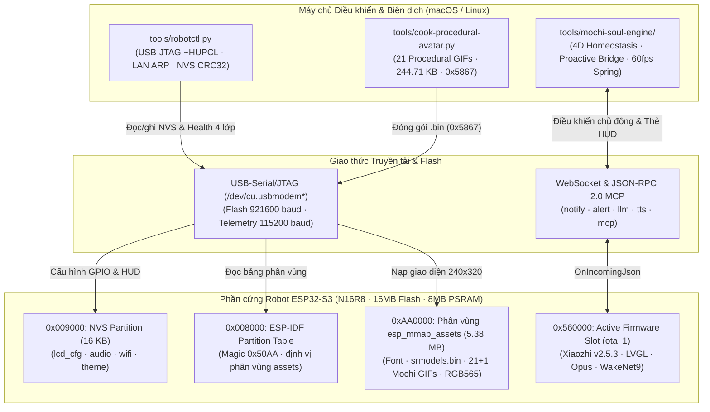

# 00 — Bản đồ Kiến trúc & Mục lục Knowledge (`DESIGN:OS Robotics`)

Tài liệu này cung cấp cái nhìn toàn cảnh về kiến trúc phần cứng **ESP32-S3 N16R8 (`RB5320XZ78AI`)**, phân vùng `esp_mmap_assets`, bộ điều khiển không xâm lấn `robotctl.py` và hệ sinh thái **Project Mochi-Soul**.

## 1. Sơ đồ kiến trúc tổng thể

## 2. Mục lục bộ tài liệu Knowledge (`knowledge/`)

1. **[02-hardware-bom-and-esp32s3-firmware-architecture.md](./02-hardware-bom-and-esp32s3-firmware-architecture.md)**: Chi tiết cấu hình phần cứng `ESP32-S3 N16R8`, các loại màn hình TFT (`ST7789`, `ILI9341`, `ILI9488`), cảm biến `HC-SR04` và sơ đồ bộ nhớ Flash ESP-IDF.
2. **[03-web-serial-flashing-and-mcp-engine.md](./03-web-serial-flashing-and-mcp-engine.md)**: Giao thức nạp qua Web Serial (`esptool-js`), cách đọc bảng phân vùng `0x8000` (magic `0x50AA`), giải nén `.bin.gz`, đọc log UART không gây reset và giao thức kết nối MCP WebSocket.
3. **[07-connected-robot-hardware-profile.md](./07-connected-robot-hardware-profile.md)**: Hồ sơ phần cứng bo mạch `RB5320XZ78AI` (`MAX98357A + PCM5102A`), ánh xạ NVS GPIO pinout và cấu trúc nhị phân phân vùng `esp_mmap_assets` tại `0xAA0000`.
4. **[08-system-optimization-and-complete-mastery.md](./08-system-optimization-and-complete-mastery.md)**: Bản đồ toàn bộ 48 chân GPIO mở rộng (Motor, `HC-SR04`, Dò line PID, SD, OLED phụ), tinh chỉnh NVS chuyên sâu và hướng dẫn vận hành bằng [robotctl.py](../tools/robotctl.py).
5. **[09-beyond-xiaozhi-capabilities-and-applications.md](./09-beyond-xiaozhi-capabilities-and-applications.md)**: Bản đồ năng lực phần cứng tối đa của `ESP32-S3 N16R8` (128-bit PIE SIMD, 8MB PSRAM, I2S Full-Duplex, BLE 5.0 HID), 3 kiến trúc tự chủ cục bộ và 10 ứng dụng mở rộng cho lập trình viên.
6. **[10-generative-ai-tamagotchi-deep-dive.md](./10-generative-ai-tamagotchi-deep-dive.md)**: Thiết kế kiến trúc **Project Mochi-Soul (Generative AI Tamagotchi)** — phương trình cân bằng nội môi (Homeostasis), mô hình cảm xúc Russell Circumplex, trí nhớ tự thuật SQLite WAL, và 4 gói tin điều khiển chủ động (`notify`, `alert`, `preview_image`, `assets.set_download_url`).
7. **[11-procedural-code-drawn-avatar-architecture.md](./11-procedural-code-drawn-avatar-architecture.md)**: Kiến trúc **Avatar Tự Vẽ Bằng Code (Procedural / Parametric Vector Face Engine)** — giảm **90.4% dung lượng GIF** (`244.71 KB` cho 21 biểu cảm) hoặc kết xuất trực tiếp **60 FPS** bằng phương trình vi phân lò xo bậc hai (`2.36 µs/frame`).
