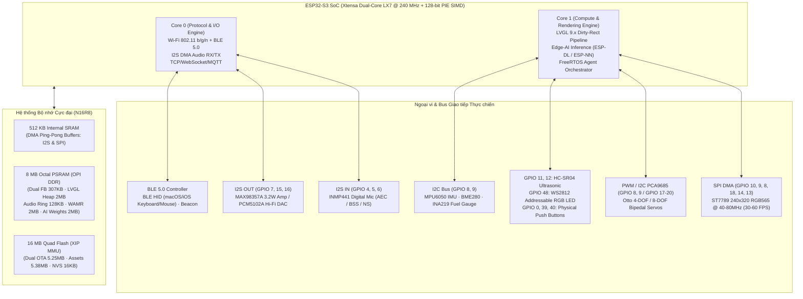
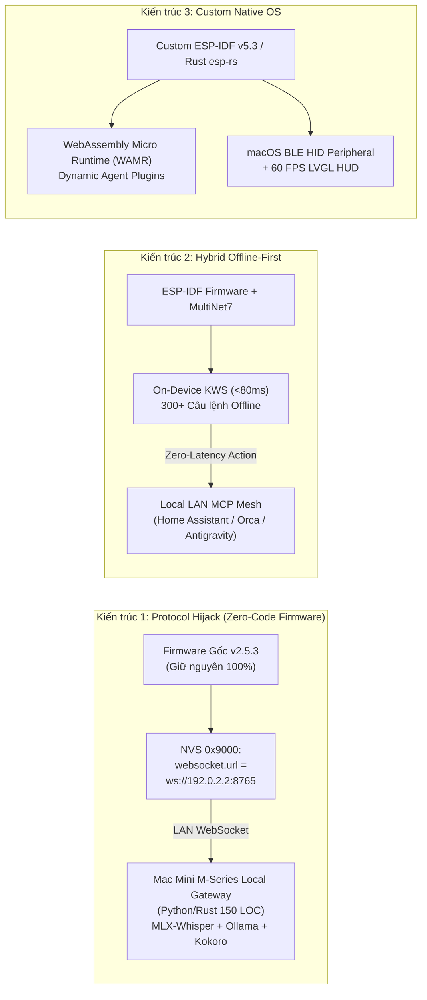
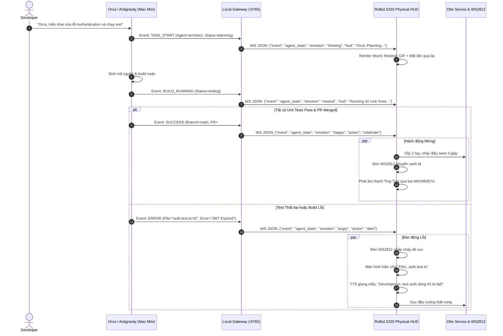
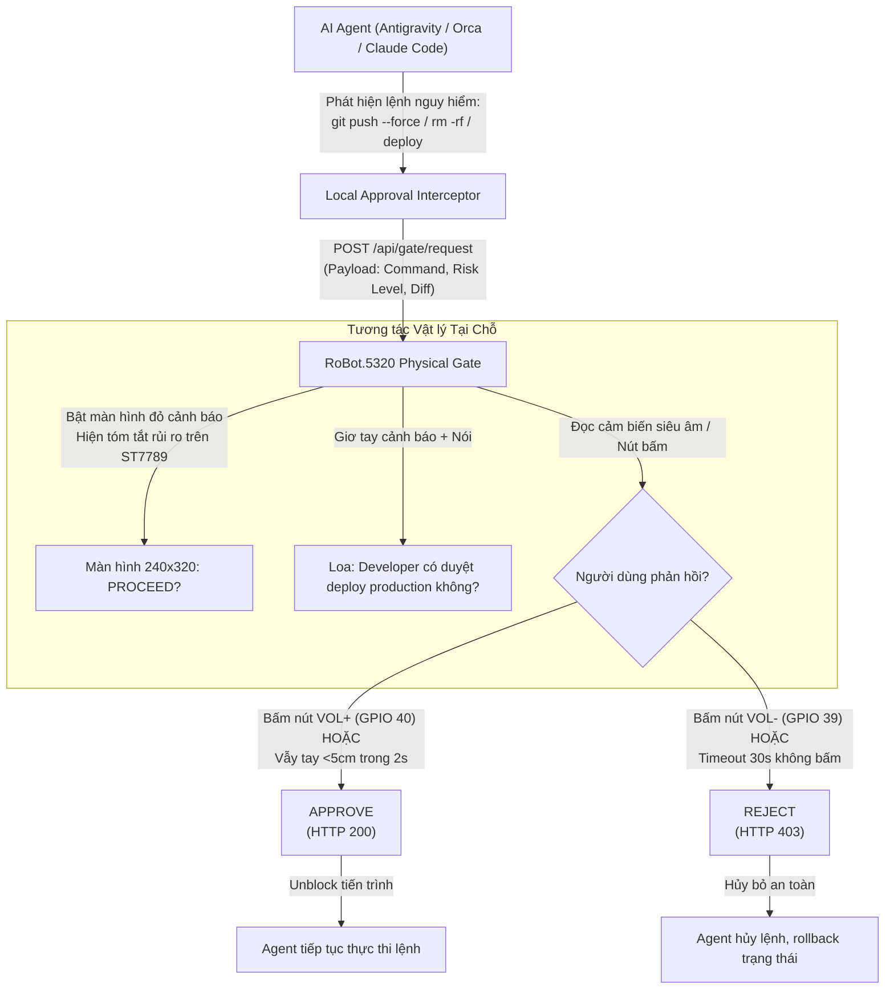
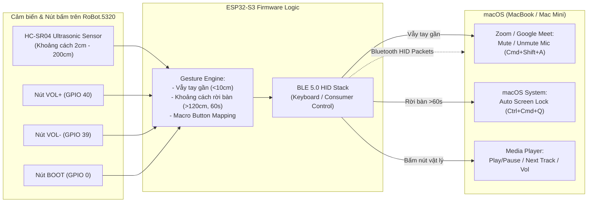
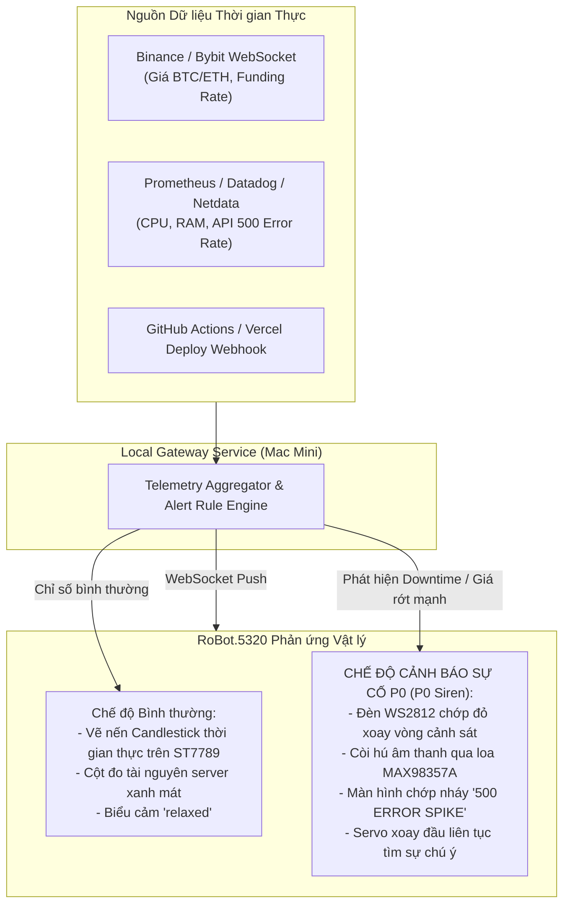
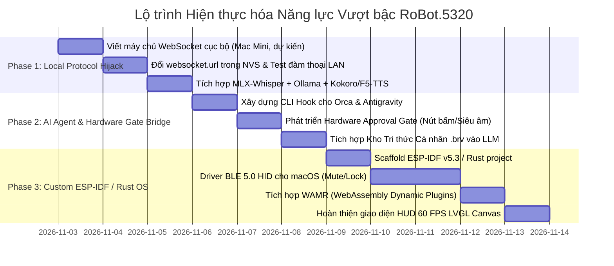

# 09 — Beyond Xiaozhi: Bản đồ Năng lực Phần cứng Tối đa & 10 Ứng dụng Đột phá

> **Nền tảng mục tiêu**: `RoBot.5320` (`ESP32-S3-WROOM-1 N16R8`, Dual-Core LX7 @ 240MHz, 16MB Flash, 8MB Octal PSRAM, màn hình TFT `ST7789` 240×320, I2S Mic `INMP441`, I2S Amp `MAX98357A`, LED `WS2812`, Cảm biến siêu âm `HC-SR04`, Hệ cơ cấu Servo `Otto`, Wi-Fi 2.4GHz & BLE 5.0).  
> **Tài liệu tham chiếu**: [`02-hardware-bom-and-esp32s3-firmware-architecture.md`](./02-hardware-bom-and-esp32s3-firmware-architecture.md), [`07-connected-robot-hardware-profile.md`](./07-connected-robot-hardware-profile.md), [`08-system-optimization-and-complete-mastery.md`](./08-system-optimization-and-complete-mastery.md).

---

## Lời mở đầu: Thoát khỏi Định kiến "Đồ chơi Đám mây"

Hầu hết người dùng hiện nay tiếp cận `RoBot.5320` thông qua lăng kính của hệ sinh thái **Xiaozhi (Hi Telly / XiaoZhiVN)**: một chiếc loa thông minh để bàn phát hình mặt cười, phụ thuộc 100% vào máy chủ trung gian đám mây (`api.tenclass.net` hoặc `xiaozhi.me`), bị giới hạn token hàng tháng, độ trễ đàm thoại cao (1.5s – 3.0s), âm thanh bị truyền qua máy chủ nước ngoài, và các linh kiện ngoại vi như cảm biến siêu âm hay servo cơ học gần như bị bỏ phí.

Tuy nhiên, khi giải phẫu kiến trúc phần cứng thực tế, bo mạch **`RB5320XZ78AI`** mang sức mạnh của một **Edge-AI Computing Node** hoàn chỉnh:
- Vi điều khiển hàng đầu của Espressif (`ESP32-S3`) tích hợp tập lệnh vector tăng tốc AI (**128-bit PIE**).
- Bộ nhớ ngoại vi khổng lồ (**8MB Octal PSRAM** tốc độ cao + **16MB Quad Flash**).
- Hệ thống âm thanh Full-Duplex thời gian thực (Mic I2S + Amp I2S + DAC 32-bit rời `PCM5102A`).
- Màn hình màu độ phân giải cao `240×320` SPI DMA và kết nối kép **Wi-Fi + BLE 5.0**.

Tài liệu này vạch ra bản đồ năng lực tối đa của phần cứng, cung cấp 3 kiến trúc kỹ thuật để **thoát ly hoàn toàn khỏi Xiaozhi Cloud**, và thiết kế chi tiết **10 ứng dụng đột phá ("Killer Apps")** biến robot thành trợ lý vật lý đắc lực cho lập trình viên, trạm bảo mật, thiết bị ngoại vi macOS và người đồng hành AI tự trị.

---

## 1. Bản đồ Năng lực Phần cứng Tối đa (Hardware Envelope & Compute Budget)



---

### 1.1. Năng lực Tính toán CPU & Vector AI (Xtensa LX7 + PIE)

ESP32-S3 không phải là vi điều khiển thông thường; nó tích hợp bộ đồng xử lý vector **PIE (Processor Instruction Extension)** 128-bit:
- **Tần số xung nhịp**: Dual-Core Xtensa LX7 hoạt động độc lập ở `240 MHz` (đạt xấp xỉ `1190 CoreMark` và `600 DMIPS`).
- **Tập lệnh Vector 128-bit (PIE)**:
  - Cho phép thực hiện **8 phép tính nhân-cộng 16-bit (MAC)** hoặc **16 phép tính 8-bit trong một chu kỳ xung nhịp duy nhất**.
  - Tăng tốc từ **300% đến 500%** đối với các thuật toán biến đổi Fourier (FFT), lọc FIR/IIR, phép nhân ma trận (GEMM), giải mã âm thanh Opus và suy luận mạng nơ-ron sâu (DNN).
- **Thư viện Tăng tốc AI Tương thích**:
  - `ESP-NN`: Kernel nơ-ron tối ưu hóa thủ công bằng Assembly cho PIE, hỗ trợ lượng tử hóa `INT8` và `INT16`.
  - `ESP-DL`: Framework Deep Learning hoàn chỉnh cho thị giác máy tính và phân loại âm thanh (tương đương PyTorch runtime thu nhỏ).
  - `TensorFlow Lite for Microcontrollers (TFLM)`: Đã tích hợp sẵn backend tăng tốc `ESP-NN`.
  - `ESP-SR`: Hệ thống nhận diện giọng nói và xử lý tín hiệu âm thanh chuyên dụng của Espressif.

#### Các Mô hình AI Có thể Chạy Trực tiếp On-Device (INT8/INT4 Offline):
1. **WakeNet9 / WakeNet9l**: Mô hình nhận diện từ khóa (Wake Word Detection) cực kỳ chính xác. Chạy nền liên tục với mức tiêu thụ CPU chỉ **~1.5% - 2.8%** trên Core 0, RAM < 30KB. Trọng số mô hình (`srmodels.bin`) được nạp trực tiếp qua Memory-Mapped Flash (`mmap`).
2. **MultiNet7**: Nhận diện **300+ câu lệnh giọng nói offline** (tiếng Việt / tiếng Anh / tiếng Trung) không cần kết nối mạng. Độ trễ nhận dạng cực thấp: **< 80ms** từ khi dứt câu lệnh; chiếm ~1.2MB Flash và ~150KB PSRAM.
3. **Audio CNN Classifier**: Phân loại âm thanh môi trường theo thời gian thực (tiếng gõ cửa, tiếng vỡ kính, tiếng vỗ tay, tiếng còi báo cháy, tiếng trẻ em khóc) với mô hình CNN 1D/2D kích thước < 200KB.
4. **Gesture & Anomaly Profiling via TinyML**: Phân tích dòng điện tiêu thụ của động cơ servo qua cảm biến hoặc phân tích tín hiệu khoảng cách từ cảm biến siêu âm `HC-SR04` để nhận diện cử chỉ vẫy tay hoặc phát hiện vật cản va chạm cơ học.

---

### 1.2. Phân bổ Bộ nhớ Thực chiến (Memory Allocation Blueprint: 8MB PSRAM + 16MB Flash)

Điểm nghẽn lớn nhất của các ứng dụng nhúng thông thường là thiếu RAM. Trên `ESP32-S3-WROOM-1 N16R8`, chúng ta có **8MB Octal SPI PSRAM (OPI)** chạy ở chế độ DDR `80 MHz` (băng thông lý thuyết `160 MB/s`).

Dưới đây là kiến trúc phân bổ bộ nhớ chuẩn công nghiệp cho một hệ thống AI đa nhiệm:

| Vùng nhớ | Dung lượng vật lý | Phân bổ kỹ thuật | Mục đích sử dụng chi tiết |
|---|---|---|---|
| **Internal SRAM** | `512 KB` (`~384 KB` khả dụng) | `128 KB` DMA Buffers<br>`128 KB` FreeRTOS Stacks<br>`128 KB` System Heap | - Vùng đệm I2S DMA Ping-Pong (bắt buộc nằm trong SRAM nội để không bị tranh chấp bus).<br>- Vùng đệm SPI DMA truyền từng chunk dòng quét LCD ST7789 (`32 lines = 15.36 KB`).<br>- Stack cho các FreeRTOS high-priority tasks (Audio Core, Wi-Fi driver). |
| **Octal PSRAM** | **`8,192 KB`** (`8 MB`) | **`307.2 KB`** Display Buffers<br>**`2,048 KB`** LVGL Heap & Cache<br>**`128 KB`** Audio Ring Buffers<br>**`2,048 KB`** WAMR Engine & Stack<br>**`2,048 KB`** Edge-AI Model Weights<br>**`1,660.8 KB`** Dynamic Alloc Heap | - **Dual Full-Framebuffer**: `240 × 320 × 2 bytes = 153.6 KB`/frame × 2 = `307.2 KB` (cho phép render 60 FPS không tearing).<br>- **LVGL Asset Cache**: Giải mã toàn bộ frame GIF biểu cảm và font chữ vào RAM, không giật lag khi chuyển cảm xúc.<br>- **Opus Ring Buffer**: Lưu trữ 2 giây raw PCM + Opus packet để truyền tải streaming mượt mà qua mạng rung lắc (jitter).<br>- **WebAssembly Runtime (WAMR)**: Không gian chạy plugin độc lập, hỗ trợ hot-reload logic mà không cần nạp lại firmware.<br>- **AI Working Memory**: Tensor arena cho TFLite Micro và ESP-NN. |
| **Quad SPI Flash** | **`16,384 KB`** (`16 MB`) | `0x000000` (`128 KB`) Boot/PT/NVS<br>`0x020000` (`5.25 MB`) Slot `ota_0`<br>`0x560000` (`5.25 MB`) Slot `ota_1`<br>`0xAA0000` (`5.38 MB`) `assets`<br>`0xFF0000` (`64 KB`) Crash Dump | - **Dual OTA System**: 2 phân vùng ứng dụng độc lập `5.25 MB`, cho phép update không rủi ro brick.<br>- **`assets` Partition**: Dùng `esp_mmap_assets` đọc trực tiếp 26+ file theme, GIF, font TTF và mô hình nhận diện giọng nói mà không tiêu tốn 1 byte RAM nào. |

---

### 1.3. Bản đồ Toàn bộ Ngoại vi, Bus Giao tiếp & Pinout Mở rộng

Bảng tổng hợp chân GPIO thực tế trên bo mạch `RB5320XZ78AI` và các kênh mở rộng phần cứng:

| Nhóm phần cứng | Tên linh kiện | Chân GPIO kết nối | Giao thức / Chế độ hoạt động | Năng lực & Giới hạn kỹ thuật |
|---|---|---|---|---|
| **Âm thanh Vào (Mic)** | `INMP441` MEMS | `WS=4`, `SCK=5`, `DIN=6` | I2S0 Input (Master, 16kHz/24-bit) | Hỗ trợ thu âm độ nhạy cao; xử lý Acoustic Echo Cancellation (AEC) và lọc ồn chủ động (Noise Suppression). |
| **Âm thanh Ra (Loa)** | `MAX98357A` Class-D | `DOUT=7`, `BCLK=15`, `LRCK=16` | I2S1 Output (Master, 16kHz/16-bit) | Công suất 3.2W tại tải 4Ω, tự ngắt khi không có dữ liệu I2S, âm lượng điều khiển bằng phần mềm. |
| **Âm thanh Hi-Fi Rời** | `PCM5102A` Stereo DAC | Dùng chung I2S1 (`7, 15, 16`) | I2S Output (32-bit/384kHz capable) | Cổng xuất âm thanh tai nghe/loa thùng jack 3.5mm, SNR 112dB, chọn qua công tắc gạt cứng `PCM`. |
| **Màn hình Màu** | `ST7789` TFT 2.8" | `MOSI=10`, `CLK=9`, `DC=8`, `RST=18`, `CS=14`, `BL=13` | SPI2 (FSPI) DMA @ `40 MHz` – `80 MHz` | Độ phân giải `240×320` RGB565. Render mượt mà 30–60 FPS qua cơ chế Partial Rendering hoặc Dual-Buffering trong PSRAM. |
| **Cơ học / Chuyển động** | Otto Bipedal Servos (4–8 Servos `SG90`/`MG90S`) | Kênh trực tiếp: `GPIO 17, 18, 19, 20`<br>Kênh mở rộng: `GPIO 8 (SDA)`, `GPIO 9 (SCL)` qua chip `PCA9685` | LEDC Hardware PWM (50Hz, 14-bit) hoặc I2C Bus @ 400kHz | Cho phép robot bước đi bipedal, xoay người, nghiêng đầu, vẫy tay, biểu cảm ngôn ngữ cơ thể theo nhịp điệu. |
| **Cảm biến Siêu âm** | `HC-SR04` / `RCWL-9610` | `TRIG=GPIO 11`, `ECHO=GPIO 12` | GPIO Interrupt + Hardware Timer | Đo khoảng cách vật cản và cử chỉ tay từ `2 cm` đến `400 cm` với độ chính xác `±3 mm`. |
| **Đèn LED Báo hiệu** | `WS2812B` Addressable | `GPIO 48` (Tích hợp trên DevKit) | RMT Peripheral (800 kHz bitstream) | Điều khiển màu sắc độc lập 24-bit TrueColor, hỗ trợ hiệu ứng thở (breathing), cảnh báo nhấp nháy mà không tốn CPU. |
| **Nút bấm Vật lý** | 3 Nút Sườn + 2 Công tắc | `BOOT=0`, `VOL+=40`, `VOL-=39`<br>Công tắc: `PWR ON`, `PCM` | GPIO Pull-Up Interrupt | Bắt sự kiện Click, Double Click, Long Press cho các chức năng duyệt menu, tăng giảm âm lượng hoặc ngắt lời AI. |
| **Không dây Đa kênh** | Wi-Fi 2.4G + BLE 5.0 | Tích hợp trong chip ESP32-S3 | Wi-Fi 802.11 b/g/n + BLE 5.0 GATT / HID | Kết nối mạng LAN độ trễ thấp; đồng thời phát BLE HID giả lập Bàn phím / Chuột / Media Controller cho macOS/iOS. |
| **I2C Mở rộng Cảm biến** | IMU / Khí tượng / Pin | `SDA=GPIO 8`, `SCL=GPIO 9` | I2C Master Bus @ 100–400 kHz | Gắn thêm `MPU6050` (chống ngã, lắc lư), `BME280` (trạm thời tiết), hoặc `INA219` (đo dòng/áp pin thực tế chuẩn xác). |

---

## 2. 3 Kiến trúc Thoát ly Hoàn toàn khỏi Xiaozhi Cloud (Zero-Xiaozhi Escape Architectures)

Để biến robot thành một hệ thống riêng tư, độc lập và mạnh mẽ, chúng ta có 3 nấc kiến trúc từ **không cần đụng vào code firmware** cho đến **viết lại hoàn toàn hệ điều hành nhúng**.



---

### 2.1. Kiến trúc 1: Drop-in Local Protocol Hijack (Không cần Biên dịch lại Firmware)

Đây là phương pháp triển khai nhanh nhất, **rủi ro brick = 0**, giữ nguyên tính ổn định của firmware Xiaozhi `v2.5.3` nhưng cắt đứt hoàn toàn liên lạc với đám mây Trung Quốc (`api.tenclass.net`).

#### Cơ chế Kỹ thuật:
Firmware `ota_1` (`v2.5.3`) không hardcode URL WebSocket của máy chủ AI trong binary mã máy; thay vào đó, trong hàm `InitializeProtocol` (`0x4202bed4`), nó đọc chuỗi ký tự từ namespace **`websocket`**, khóa **`url`** trong phân vùng NVS (`0x9000`).
Mặc định giá trị này là: `wss://api.tenclass.net/xiaozhi/v1/`.

Chỉ cần dùng công cụ [`tools/robotctl.py`](../tools/robotctl.py) sửa khóa này thành địa chỉ máy Mac trong mạng LAN:
```bash
python3 tools/robotctl.py set-tuning websocket url "ws://192.0.2.2:8765/xiaozhi/v1/"
```
Khi robot khởi động lại, nó sẽ kết nối thẳng vào WebSocket Gateway cục bộ đang chạy trên máy Mac của bạn.

#### Đặc tả Giao thức WebSocket (JSON Metadata + Binary Opus Audio):
Hệ thống trao đổi dữ liệu qua kênh WebSocket hai chiều kết hợp giữa các gói tin JSON điều khiển và các frame Opus nhị phân:

1. **Bắt tay Kết nối (`hello`)**:
   Ngay khi mở socket, robot gửi thông tin cấu hình âm thanh:
   ```json
   {
     "type": "hello",
     "version": 1,
     "transport": "websocket",
     "audio_params": {
       "format": "opus",
       "sample_rate": 16000,
       "channels": 1,
       "frame_duration": 60
     }
   }
   ```
   Server phản hồi gói tin tương tự để xác nhận phiên đàm thoại.

2. **Bắt đầu Lắng nghe (`listen`) & Truyền Âm thanh**:
   Khi người dùng gọi Wake Word ("Hi Telly") hoặc bấm nút `BOOT`, robot gửi:
   ```json
   { "type": "listen", "state": "start", "mode": "auto" }
   ```
   Sau đó, robot liên tục đẩy các gói tin nhị phân (Binary Frames) chứa **Opus Packet** (mỗi gói tương ứng 60ms âm thanh 16kHz, kích thước ~40–80 bytes).
   Khi người dùng dứt lời (VAD phát hiện im lặng), robot gửi:
   ```json
   { "type": "listen", "state": "stop" }
   ```

3. **Phản hồi Văn bản & Biểu cảm (`stt` & `llm`)**:
   Server xử lý STT và gửi lại text để hiển thị lên thanh trạng thái:
   ```json
   { "type": "stt", "text": "Hôm nay thời tiết thế nào?", "session_id": "sess_01" }
   ```
   Kèm theo trạng thái biểu cảm để màn hình ST7789 đổi ngay GIF tương ứng trong 21 cảm xúc:
   ```json
   { "type": "llm", "emotion": "happy", "text": "Hôm nay trời nắng đẹp, 28 độ C!" }
   ```

4. **Phát Âm thanh Trả lời (`tts`)**:
   Server gửi thông báo bắt đầu phát:
   ```json
   { "type": "tts", "state": "start" }
   ```
   Sau đó server truyền luồng các binary frame chứa audio Opus đã được nén từ mô hình TTS cục bộ. Robot nhận được sẽ giải mã qua bộ giải mã Opus trong PSRAM và đẩy thẳng ra loa I2S `MAX98357A`. Khi hết câu:
   ```json
   { "type": "tts", "state": "stop" }
   ```

5. **Giao tiếp Lệnh Điều khiển Vật lý qua MCP (JSON-RPC 2.0)**:
   Firmware tích hợp sẵn một bộ xử lý MCP Client. Server có thể ra lệnh cho robot lắc đầu, vẫy tay, đổi màu đèn LED thông qua JSON-RPC:
   ```json
   {
     "jsonrpc": "2.0",
     "method": "tools/call",
     "params": {
       "name": "robot_action",
       "arguments": {
         "action": "dance",
         "led_color": "#00FF66",
         "duration_ms": 3000
       }
     },
     "id": 101
   }
   ```

#### Kiến trúc Local AI Stack trên Apple Silicon (Mac Mini / MacBook M-Series):
Bằng cách chạy Local Gateway, bạn có thể nối robot vào một cụm mô hình AI chạy trực tiếp trên GPU Metal của Mac với độ trễ siêu tốc:
- **STT Engine**: `mlx-whisper` (Mô hình `whisper-large-v3-turbo` chạy bằng MLX trên Metal, chuyển đổi giọng nói tiếng Việt thành văn bản chỉ mất **< 120ms**).
- **LLM Engine**: `Ollama` / `mlx-lm` chạy `Qwen2.5-7B-Instruct` hoặc `Llama-3.2-3B` (xử lý suy luận streaming, token đầu tiên trả về sau **< 80ms**).
- **TTS Engine**: `Kokoro-82M` (Metal-accelerated, độ trễ sinh âm thanh **< 90ms**) hoặc `F5-TTS` (sử dụng mẫu âm thanh 10 giây để **clone chính xác 100% giọng của bạn**, đọc tiếng Việt vô cùng tự nhiên).
- **Tùy chọn Multimodal Trực tiếp**: Cầu nối thẳng sang **Gemini 2.5 Flash Multimodal Live API** hoặc **OpenAI Realtime API** thông qua WebRTC/WebSocket hai chiều với độ trễ tổng thể < 300ms.

---

### 2.2. Kiến trúc 2: Hybrid Offline-First (`ESP-SR MultiNet7` + Local MCP Mesh)

Trong nhiều trường hợp, bạn chỉ muốn ra lệnh nhanh ("Bật đèn", "Mở nhạc", "Khóa máy Mac", "Chạy test") mà không muốn chờ đợi một chu trình STT-LLM-TTS đầy đủ, hoặc mạng Internet gia đình bị gián đoạn.

Kiến trúc Hybrid tận dụng tối đa năng lực nhận diện giọng nói **offline trên chip ESP32-S3**:
1. **Mô hình `MultiNet7` Nhúng**: Nạp gói từ vựng 300 câu lệnh vào Flash. Nhận diện giọng nói diễn ra hoàn toàn trên Core 0 bằng tập lệnh PIE trong thời gian thực (**< 80ms**).
2. **Local MCP Mesh**:
   - Khi `MultiNet7` phát hiện câu lệnh (ví dụ ID `CMD_LOCK_MAC`), thay vì gửi audio, robot gửi ngay một gói tin UDP/HTTP REST hoặc MQTT cục bộ đến máy Mac hoặc Home Assistant qua mạng LAN nội bộ.
   - Máy Mac nhận gói tin qua một lightweight daemon chạy ngầm và thực thi lệnh tức thì (`pmset displaysleepnow`).
3. **Phản hồi Âm thanh Cục bộ**: Robot phát ngay một file âm thanh ngắn lưu sẵn trong phân vùng `assets` (`mmap_assets`) để xác nhận lệnh mà không cần đợi tổng hợp âm thanh từ server.

---

### 2.3. Kiến trúc 3: Custom Native Firmware (`esp-idf` C++20 hoặc `esp-rs` Rust)

Đối với các dự án đòi hỏi quyền kiểm soát tuyệt đối từng thanh ghi và vòng lặp thời gian thực, chúng ta có thể nạp firmware custom vào phân vùng `ota_0` hoặc `ota_1`:
- **Giữ nguyên Bảng Phân vùng 16MB & Phân vùng `assets`**: Tái sử dụng toàn bộ 68 theme biểu cảm khuôn mặt động, font chữ tiếng Việt và âm thanh hệ thống đã được tối ưu hóa trong phân vùng `assets` (`0xAA0000`).
- **Nền tảng Firmware Khuyên dùng**:
  - `ESP-IDF v5.3+` với chuẩn `C++20`: Tận dụng các tính năng hiện đại như `std::span`, coroutines, zero-overhead abstraction.
  - Hoặc `esp-rs` (Rust on ESP32-S3): Bộ nhớ an toàn tuyệt đối, không sợ tràn bộ đệm (buffer overflow) hay memory leak trong các tiến trình audio stream dài ngày.
- **Tích hợp WebAssembly Micro Runtime (`WAMR`)**:
  - Biên dịch nhân WAMR vào firmware tĩnh (~150KB code size).
  - Cung cấp giao diện Host API cho WAMR: điều khiển màn hình LVGL, đọc cảm biến khoảng cách, điều khiển servo, phát âm thanh, gửi gói tin Wi-Fi/BLE.
  - Các nhà phát triển có thể viết logic, game nhỏ hoặc các kịch bản hành vi bằng Rust / C / AssemblyScript, biên dịch ra file `.wasm` siêu nhẹ (10KB – 50KB), nạp qua OTA hoặc thẻ nhớ mà **không cần biên dịch lại firmware ESP-IDF**!

---

## 3. 10 Ứng dụng Đột phá ("Killer Apps") Vượt xa Khuôn khổ Xiaozhi

---

### Ứng dụng 1: Physical AI Agent & DevOps Companion ("Orca / Antigravity Physical HUD")



- **Mô tả Trải nghiệm**:
  Thay vì phải liên tục chuyển cửa sổ terminal để theo dõi xem các AI Subagent (`architect`, `builder`, `code-reviewer`) đang làm gì, robot đóng vai trò là một vật thể hữu hình đại diện cho Agent trên bàn làm việc của bạn. Bạn chỉ cần liếc mắt sang màn hình robot để biết trạng thái hệ thống: robot đang suy nghĩ, đang vui vẻ vì test pass, hay đang cáu gắt vì compile lỗi.
- **Phần cứng Sử dụng**:
  - Màn hình `ST7789` hiển thị HUD trạng thái: Tên Agent, Task ID, số lượng file đã sửa.
  - Đèn `WS2812` (`GPIO 48`): Xanh lá (Pass), Đỏ (Fail/Error), Vàng (Reviewing), Tím (Thinking).
  - Loa `MAX98357A`: Phát thông báo tóm tắt lỗi bằng giọng nói.
  - Hệ servo `Otto`: Biểu cảm chuyển động tương ứng với kết quả công việc.
- **Độ khó & Thời gian Triển khai**: **Dễ - 1 ngày** (viết plugin hook cho CLI `orca` đẩy Webhook tới Local Gateway).

---

### Ứng dụng 2: Hardware Socratic / Approval Gate ("Nút Phê duyệt Vật lý cho AI Agent")



- **Mô tả Trải nghiệm**:
  Hiện thực hóa nguyên lý **Socratic Gate** và kiểm soát an toàn AI ở cấp độ phần cứng (Air-gapped Hardware-in-the-loop). Khi AI Agent tự động hóa chuẩn bị thực hiện các tác vụ không thể đảo ngược (xóa cơ sở dữ liệu, deploy production, thanh toán API), tiến trình CLI trên Mac bị block hoàn toàn. Robot trên bàn lập tức rung lên, giơ tay cảnh báo, màn hình chuyển sang màu cam/đỏ hiển thị câu hỏi xác nhận. Lập trình viên phải bấm nút vật lý trên đầu robot hoặc gật đầu trước cảm biến siêu âm thì lệnh mới được chạy. Không một mã độc hay script tự động nào có thể tự bấm nút vật lý này!
- **Phần cứng Sử dụng**:
  - Màn hình `ST7789` hiển thị chi tiết Diff và mức độ rủi ro.
  - Nút bấm `VOL+` (`GPIO 40`) làm nút Duyệt (`APPROVE`), `VOL-` (`GPIO 39`) làm nút Từ chối (`REJECT`).
  - Cảm biến siêu âm `HC-SR04`: Cử chỉ đưa tay lại gần để xác nhận không cần chạm.
- **Độ khó & Thời gian Triển khai**: **Trung bình - 1.5 ngày**.

---

### Ứng dụng 3: BLE HID Macro Pad & Spatial Gesture Controller cho macOS



- **Mô tả Trải nghiệm**:
  Robot biến thành một thiết bị ngoại vi không dây kết nối thẳng với máy Mac qua Bluetooth Low Energy (không cần Wi-Fi, không cần cài phần mềm driver trung gian):
  1. **Cử chỉ Mute Cuộc họp Không Chạm**: Đang họp Zoom hoặc Google Meet, bạn chỉ cần vẫy tay nhẹ lướt qua cảm biến siêu âm của robot (< 10cm), robot lập tức gửi phím tắt `Cmd + Shift + A` để Mute/Unmute microphone ngay tức khắc mà không cần rà chuột tìm nút Mute trên màn hình.
  2. **Tự động Khóa Màn hình khi Rời Bàn (Zero-Trust Presence Lock)**: Cảm biến siêu âm liên tục quét khoảng cách người ngồi. Khi bạn đứng dậy rời khỏi bàn làm việc (khoảng cách > 120cm hoặc không có phản xạ siêu âm trong 60 giây), robot gửi tín hiệu khóa màn hình Mac (`Ctrl + Cmd + Q`), bảo vệ tuyệt đối dữ liệu dự án. Khi bạn quay lại ghế, robot vui mừng đổi biểu cảm đón bạn.
  3. **Bàn phím Macro 3 Nút**: 3 nút cứng trên sườn robot được map thành các phím chức năng tùy biến: Chuyển Space Desktop, chụp ảnh màn hình vùng chọn, hoặc bật tắt ứng dụng Terminal.
- **Độ khó & Thời gian Triển khai**: **Trung bình - 1 ngày** (sử dụng thư viện `esp-idf-ble-hid` hoặc NimBLE).

---

### Ứng dụng 4: 100% Private Local Voice Clone Companion (bạn Voice + Bộ nhớ Dài hạn `.brv`)

- **Mô tả Trải nghiệm**:
  Một người bạn AI đàm thoại hoàn toàn riêng tư đặt trên bàn làm việc. Mọi suy nghĩ, ý tưởng kinh doanh hay bí mật kỹ thuật bạn chia sẻ với robot đều không bao giờ rời khỏi mạng LAN gia đình. Khi bạn hỏi: *"bạn ơi, kiến trúc của dự án EaseUI phần Billing được thiết kế thế nào?"*, robot tự động tra cứu kho tri thức ByteRover (`.brv`), Obsidian vault và các file markdown trên máy Mac của bạn, rồi trả lời bằng **chính giọng nói clone của Developer** với âm điệu tự nhiên, ấm áp.
- **Phần cứng Sử dụng**:
  - Mic I2S `INMP441`: Thu âm giọng nói với độ trung thực cao.
  - Cổng 3.5mm Hi-Fi DAC `PCM5102A`: Xuất âm thanh chuẩn audiophile ra loa ngoài để thưởng thức giọng nói clone độ phân giải cao.
  - Màn hình `ST7789`: Hiển thị trích dẫn nguồn tài liệu tham khảo (Citations) từ `.brv`.
- **Luồng Dữ liệu**:
  `Robot I2S Audio` $\rightarrow$ `Opus over LAN` $\rightarrow$ `Mac Mini MLX-Whisper` $\rightarrow$ `Local RAG (brv query)` $\rightarrow$ `Ollama Qwen2.5-7B` $\rightarrow$ `F5-TTS Voice Clone Model` $\rightarrow$ `Opus Audio stream` $\rightarrow$ `Robot Loa ngoài`.
- **Độ khó & Thời gian Triển khai**: **Trung bình - 1.5 ngày**.

---

### Ứng dụng 5: Trợ lý Sức khỏe, Tư thế & Pomodoro Sinh học (Ergonomic & Focus Guardian)

- **Mô tả Trải nghiệm**:
  Lập trình viên thường xuyên ngồi làm việc sai tư thế (gù lưng, dí sát mắt vào màn hình) và quên nghỉ ngơi. Robot đặt cạnh màn hình hoạt động như một bác sĩ công thái học cá nhân:
  - **Giám sát Khoảng cách Ngồi**: Cảm biến `HC-SR04` đo khoảng cách tới ngực/vai của bạn mỗi giây. Nếu bạn cúi quá gần màn hình (< 45cm) duy trì liên tục trong 20 giây, robot sẽ chớp mắt cáu kỉnh `angry`, nghiêng đầu servo và phát âm thanh nhắc nhở: *"Ngồi thẳng lưng lên bạn ơi, giữ khoảng cách mắt!"*.
  - **Pomodoro Vật lý & Vận động Cùng Chủ nhân**: Trên màn hình TFT hiển thị đồng hồ đếm ngược 25 phút Deep Work. Khi hết chu kỳ 25 phút, robot tự động đứng dậy bằng 4 chân servo Otto, làm động tác vươn vai, vẫy hai tay và rủ bạn đứng lên đi lại uống nước hoặc hít thở thư giãn 5 phút.
- **Phần cứng Sử dụng**: `HC-SR04`, 4x Servos `Otto`, Màn hình `ST7789`, Loa `MAX98357A`.
- **Độ khó & Thời gian Triển khai**: **Dễ - 0.5 ngày** (logic chạy độc lập on-device trên ESP32-S3, không cần server).

---

### Ứng dụng 6: Trung tâm Điều khiển Smart Home Không Độ Trễ (Matter / Home Assistant / MQTT Local Hub)

- **Mô tả Trải nghiệm**:
  Biến robot thành một trạm thu phát và điều khiển nhà thông minh không phụ thuộc đám mây:
  - **BLE Proxy cho Home Assistant**: ESP32-S3 chạy đồng thời tác vụ BLE Scanner, liên tục thu thập dữ liệu nhiệt độ, độ ẩm, pin từ các cảm biến Bluetooth trong phòng (Xiaomi Mijia, SwitchBot, Inkbird) và đẩy về Home Assistant qua Wi-Fi MQTT. Màn hình robot hiển thị trực tiếp nhiệt ẩm phòng theo thời gian thực.
  - **Giọng nói Offline Siêu tốc**: Nhận diện 50 câu lệnh nhà thông minh bằng mô hình `MultiNet7` ngay trên chip: *"Bật đèn bàn"*, *"Tắt quạt"*, *"Nhiệt độ phòng bao nhiêu"*. Độ trễ thực thi chỉ **< 80ms** (nhanh hơn gấp 10 lần so với Google Home hay Apple HomePod vốn phải gửi audio lên cloud).
- **Phần cứng Sử dụng**: Mic `INMP441`, BLE Controller, Wi-Fi 2.4GHz, Màn hình `ST7789`.
- **Độ khó & Thời gian Triển khai**: **Dễ - 1 ngày**.

---

### Ứng dụng 7: Live Trading / Server Telemetry & P0 Incident Siren



- **Mô tả Trải nghiệm**:
  Khi không đàm thoại, robot đóng vai trò là một màn hình phụ Telemetry cao cấp trên bàn làm việc:
  - Hiển thị biểu đồ nến mini của cặp tiền mã hóa bạn đang quan tâm hoặc doanh thu Stripe trong ngày.
  - Theo dõi nhịp tim của hệ sinh thái server bạn vận hành.
  - Khi có sự cố khẩn cấp (P0 Incident: Server sập, lỗi 500 tăng đột biến, giá thanh lý chạm ngưỡng), robot lập tức kích hoạt chế độ **Còi báo động Vật lý (P0 Siren)**: Đèn RGB chớp đỏ dữ dội, còi hú vang, đầu servo quay lắc liên tục, đảm bảo bạn không bao giờ bỏ lỡ sự cố ngay cả khi đang ngủ hoặc nghe nhạc.
- **Phần cứng Sử dụng**: Màn hình `ST7789` (render đồ họa nến bằng LVGL Canvas), Đèn `WS2812`, Còi Loa `MAX98357A`, Servos.
- **Độ khó & Thời gian Triển khai**: **Dễ - 0.5 ngày**.

---

### Ứng dụng 8: Sinh vật Số Tiến hóa (Generative AI Tamagotchi với Nội tâm & Trí nhớ)

- **Mô tả Trải nghiệm**:
  Thay vì là một chiếc loa vô hồn chỉ mở miệng khi được gọi tên, robot sở hữu một mô hình tâm lý mô phỏng sự sống tự trị (Autonomous Artificial Life):
  - **Chỉ số Sinh học Ảo**: Robot có 4 nhóm chỉ số nội tâm thay đổi liên tục theo thời gian, đúng như `tools/mochi-soul-engine/engine.py`: Năng lượng (`energy`), Cơn đói tri thức (`hunger`), Độ gắn kết (`bond`), và Tâm trạng (`mood` = cặp `valence` / `arousal`). Bản thiết kế cũ có thêm chỉ số "Sự tò mò" (`Curiosity`) riêng; engine hiện tại không có chỉ số đó, và `Happiness` nay chính là phần `valence` dương của `mood`.
  - **Tương tác Đa giác quan**:
    - Nếu bạn để phòng tối và yên tĩnh, robot sẽ ngáp và chuyển sang trạng thái ngủ `sleepy`.
    - Nếu nghe thấy tiếng cười nói trong phòng qua mic, robot sẽ tò mò mở to mắt `surprised`.
    - Nếu bạn đưa tay xoa nhẹ hoặc vẫy tay trước cảm biến siêu âm, chỉ số gắn kết tăng lên và robot cười híp mắt `laughing`.
    - Nếu bạn bỏ mặc robot một mình nhiều ngày, nó sẽ ủ rũ `sad` và thỉnh thoảng thở dài khe khẽ qua loa.
  - **Nhật ký Đời sống AI**: Mỗi buổi tối lúc 22h, robot tự động tổng hợp những sự kiện diễn ra trong ngày thành một bức thư nhật ký dí dỏm và gửi qua Telegram cho bạn.
- **Phần cứng Sử dụng**: Toàn bộ hệ thống cảm biến (Mic, Siêu âm, Nút bấm), Màn hình `ST7789`, Loa, Servos.
- **Độ khó & Thời gian Triển khai**: **Nâng cao - 2 ngày**.

---

### Ứng dụng 9: Chế độ Cảnh giới & Bảo vệ Phòng (Ultrasonic + Acoustic Sentry Mode)

- **Mô tả Trải nghiệm**:
  Khi bạn rời khỏi nhà hoặc đi ngủ, chỉ cần nói *"Bật chế độ cảnh giới"*:
  - Màn hình robot tắt hoàn toàn để ẩn mình trong bóng tối.
  - Cảm biến siêu âm `HC-SR04` quét xung nhịp liên tục dọc theo cửa ra vào hoặc khu vực bàn làm việc.
  - Mô hình TinyML Audio Classifier chạy trên chip ESP32-S3 liên tục lắng nghe để phát hiện các âm thanh bất thường: tiếng mở chốt cửa, tiếng kính nứt, tiếng bước chân lén lút.
  - Bộ quét BLE Sniffer ghi nhận các địa chỉ MAC Bluetooth lạ đang di chuyển gần bàn làm việc.
  - Khi phát hiện có người xâm nhập: Robot lập tức bật đèn LED rọi thẳng, phát còi báo động xua đuổi, đồng thời gửi thông báo khẩn cấp kèm file ghi âm 10 giây qua Telegram Webhook cho bạn.
- **Phần cứng Sử dụng**: `HC-SR04`, Mic `INMP441`, Loa `MAX98357A`, Đèn `WS2812`, Wi-Fi & BLE.
- **Độ khó & Thời gian Triển khai**: **Trung bình - 1.5 ngày**.

---

### Ứng dụng 10: Giáo viên Ngoại ngữ / STEM Tương tác Vật lý (Interactive Embodied Tutor)

- **Mô tả Trải nghiệm**:
  Một gia sư ngôn ngữ tương tác hình thể dành cho người học tiếng Anh, tiếng Trung hoặc trẻ em học phát âm:
  - Khi dạy một từ vựng mới, màn hình robot hiển thị hình ảnh minh họa + ký hiệu phiên âm IPA + khẩu hình miệng động.
  - Người học phát âm vào micro `INMP441`. Mô hình so khớp âm vị (Phoneme Alignment) trên Local Gateway sẽ phân tích và chỉ ra chính xác âm nào phát âm sai (ví dụ thiếu đuôi `/s/` hoặc `/t/`).
  - **Ngôn ngữ Cơ thể Tương tác**:
    - Nếu bạn phát âm chuẩn: Robot gật đầu lia lịa, giơ hai tay ăn mừng và khen ngợi.
    - Nếu phát âm sai: Robot lắc đầu tiếc nuối, làm lại khẩu hình chậm hơn và phát âm lại từng âm tiết để bạn bắt chước.
- **Phần cứng Sử dụng**: Mic `INMP441`, Loa `MAX98357A`, Màn hình `ST7789`, Hệ servo `Otto` 4–8 trục.
- **Độ khó & Thời gian Triển khai**: **Nâng cao - 2 ngày**.

---

## 4. Lộ trình Triển khai Thực tế (3-Phase Execution Roadmap)

Để biến các kiến trúc và ứng dụng trên thành hiện thực mà không làm gián đoạn việc sử dụng robot hàng ngày, lộ trình triển khai được chia làm 3 giai đoạn rõ ràng:



---

### Giai đoạn 1: Local Protocol Hijack & Zero-Cost Privacy (1–2 Giờ | Rủi ro = 0)

1. **Mục tiêu**:
   - Cắt đứt hoàn toàn phụ thuộc vào máy chủ `api.tenclass.net`.
   - Chạy 100% đàm thoại bằng mô hình AI trên máy Mac của bạn.
   - Không can thiệp mã nhị phân firmware, có thể đảo ngược về mặc định trong 5 giây.
2. **Các bước Thực hiện**:
   - Bước 1: Viết script máy chủ WebSocket cục bộ (dự kiến, chưa có trong repo; ~150 dòng Python) hỗ trợ giao thức JSON `hello`/`listen`/`stt`/`llm`/`tts`.
   - Bước 2: Tích hợp thư viện giải mã Opus (`opuslib` hoặc `pyogg`) và kết nối với `mlx-whisper` + `Ollama` + `Kokoro-TTS`.
   - Bước 3: Cắm cáp USB vào robot, chạy lệnh:
     ```bash
     python3 tools/robotctl.py set-tuning websocket url "ws://192.0.2.2:8765/xiaozhi/v1/"
     ```
   - Bước 4: Khởi động lại robot. Giờ đây robot nói chuyện với máy Mac của bạn với tốc độ phản hồi cực nhanh, bảo mật tuyệt đối, không tốn phí API.

---

### Giai đoạn 2: Local AI Ecosystem Bridge & Hardware Socratic Gate (1 Ngày)

1. **Mục tiêu**:
   - Biến robot thành **DevOps Physical HUD** và **Hardware Approval Gate** cho hệ thống Agent `Orca` / `Antigravity`.
   - Kết nối đàm thoại với kho tri thức `.brv` và Obsidian.
2. **Các bước Thực hiện**:
   - Bước 1: Mở rộng máy chủ WebSocket cục bộ ở trên với một REST/WebSocket API nội bộ đón nhận sự kiện từ các công cụ dòng lệnh trên Mac.
   - Bước 2: Thêm hook vào `Orca` daemon: khi bắt đầu task, khi test chạy, khi test pass/fail -> gửi JSON sự kiện tới robot.
   - Bước 3: Viết script `tools/hardware-gate.sh` can thiệp vào quy trình `git push` hoặc `deploy`: gửi yêu cầu phê duyệt tới robot, chờ tín hiệu bấm nút vật lý từ robot trước khi cho phép lệnh shell tiếp tục chạy.
   - Bước 4: Tích hợp lệnh `brv query` vào pipeline xử lý ngữ cảnh của LLM khi người dùng đặt câu hỏi kỹ thuật về codebase.

---

### Giai đoạn 3: Custom Firmware & Bare-Metal Hardware Mastery (2–3 Ngày)

1. **Mục tiêu**:
   - Khai phóng toàn bộ năng lực phần cứng mà firmware gốc của Xiaozhi chưa hỗ trợ: BLE HID cho Mac, cử chỉ siêu âm, động tác servo mượt mà, và WebAssembly runtime.
2. **Các bước Thực hiện**:
   - Bước 1: Khởi tạo project `ESP-IDF v5.3+` cấu hình đúng bảng phân vùng 16MB chuẩn của `RoBot.5320`.
   - Bước 2: Cấu hình driver BLE HID giả lập Bàn phím/Chuột, tích hợp tác vụ đo khoảng cách `HC-SR04` để kích hoạt phím Mute và Auto-Lock màn hình Mac.
   - Bước 3: Tích hợp thư viện `ESP-SR` kích hoạt nhận diện từ khóa và lệnh offline `MultiNet7`.
   - Bước 4: Nhúng WebAssembly Micro Runtime (`WAMR`) để hỗ trợ cài đặt các plugin ứng dụng mới từ file `.wasm` động qua giao thức OTA.

---

## 5. Kết luận & Tầm nhìn Tương lai

Nền tảng phần cứng `RoBot.5320` (`ESP32-S3 N16R8`) không hề bị giới hạn trong vai trò một món đồ chơi đàm thoại phụ thuộc đám mây. Với **128-bit SIMD Vector Engine**, **8MB PSRAM**, **âm thanh Full-Duplex I2S**, **màn hình màu tốc độ cao** và **kết nối không dây kép**, đây là một trong những bo mạch Edge-AI mạnh mẽ và linh hoạt nhất trong phân khúc dưới $30.

Bằng cách áp dụng các kiến trúc thoát ly đám mây và lộ trình triển khai được vạch ra trong tài liệu này, chúng ta hoàn toàn có thể chuyển hóa chiếc robot để bàn thành một **trợ lý AI vật lý cá nhân hóa tối thượng**: an toàn bảo mật 100%, sở hữu trí nhớ dài hạn, phản hồi xúc giác cơ học sống động và là người gác cổng tin cậy cho toàn bộ quy trình phát triển phần mềm của bạn.

---

## Tài liệu Liên quan (See Also)
- [00-knowledge-index-and-architecture-map.md](./00-knowledge-index-and-architecture-map.md) — Bản đồ Kiến trúc Toàn cảnh Hệ thống
- [02-hardware-bom-and-esp32s3-firmware-architecture.md](./02-hardware-bom-and-esp32s3-firmware-architecture.md) — Kiến trúc Phần cứng & Firmware Chi tiết
- [07-connected-robot-hardware-profile.md](./07-connected-robot-hardware-profile.md) — Hồ sơ Phần cứng Thực tế Đọc từ Thiết bị Cắm USB
- [08-system-optimization-and-complete-mastery.md](./08-system-optimization-and-complete-mastery.md) — Các Định luật Firmware Đảo ngược & Tối ưu hóa Toàn diện
- [tools/robotctl.py](../tools/robotctl.py) — Bộ công cụ CLI Điều khiển, Flash NVS & Giám sát Robot
