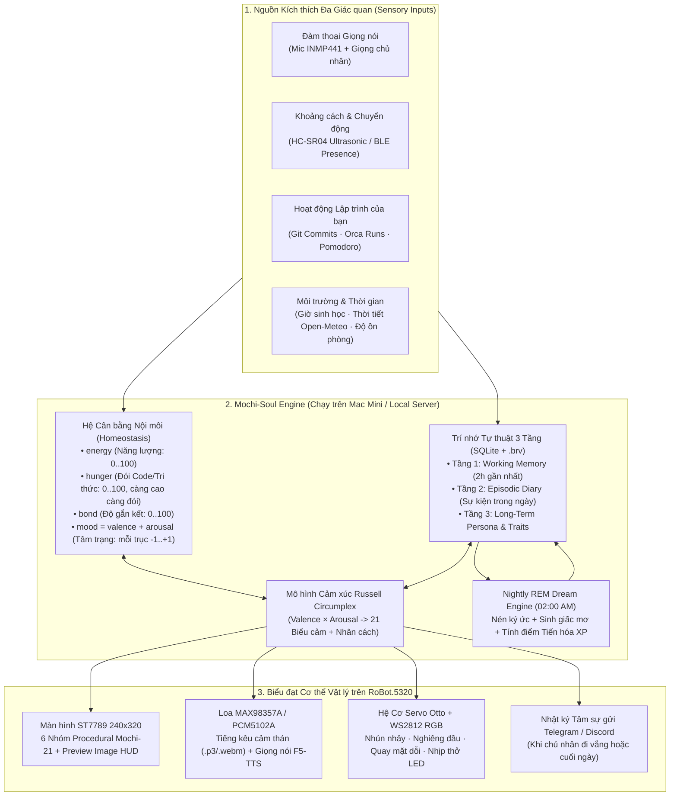
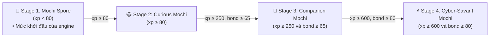

# 10 — Deep-Dive: Generative AI Tamagotchi ("Project Mochi-Soul") trên Phần cứng `RoBot.5320`

> **Mục tiêu**: Biến `RoBot.5320` (`ESP32-S3 N16R8` + Màn hình `ST7789 240x320` + Khuôn mặt `Procedural Mochi-21` + Hệ cơ `Otto` + Cảm biến `HC-SR04` + Mic `INMP441`) từ một chiếc loa AI bị động (chỉ mở miệng khi nghe gọi *"Hi, Tell me"*) thành một **Sinh vật Số Có Nội tâm, Nhịp sinh học, Ký ức Dài hạn và Khả năng Tiến hóa Hình thái Tự trị (Autonomous Embodied Digital Lifeform)**.

---

## 1. Tại sao 99% "AI Desktop Pet" Hiện nay Thất bại — và Giải pháp của `Mochi-Soul`

| Điểm yếu của AI Pet thông thường (Xiaozhi / Loona / Eilik) | Cách `Mochi-Soul` Giải quyết Tận gốc |
|---|---|
| **1. Bị động hoàn toàn (Reactive-Only)**: Im lìm như cục gạch cho tới khi người dùng đọc Wake Word. | **Spontaneous Agency (Chủ động Tự phát)**: Có động cơ nội tâm chạy ngầm 24/7. Tự biết thở dài khi chán, tự ngáp khi khuya, tự gọi tên chủ nhân khi đói hoặc khi thấy chủ nhân ngồi vào bàn làm việc. |
| **2. "Mất trí nhớ" sau mỗi phiên (Stateless Chatbot)**: Mỗi lần hội thoại là một phiên LLM trắng hoặc chỉ nhớ vài câu gần nhất. | **3-Tier Autobiographical Memory + Giấc mơ Ban đêm (REM Consolidation)**: Nhớ từng sự kiện trong ngày, gom nén ký ức lúc 02:00 sáng và định hình tính cách theo cách bạn đối xử. |
| **3. Biểu cảm ngẫu nhiên hoặc giả tạo**: Lặp đi lặp lại vài hiệu ứng cố định không liên quan tới trạng thái sinh học. | **Homeostasis & Circumplex Affective Engine**: Biểu cảm trên màn hình `240x320` là hàm toán học trực tiếp của 5 chỉ số sinh học nội môi (`energy`, `hunger`, `bond`, `valence`, `arousal`). |
| **4. Cơ chế "Cho ăn" nhàm chán**: Phải mở app điện thoại bấm nút "Feed" vô nghĩa. | **Symbiotic Developer Feeding ("Work-to-Feed")**: Sống cộng sinh với lập trình viên — thức ăn của Mochi là **Git Commits**, **PR Merged**, **Pomodoro Deep Work**, và những cuộc trò chuyện thực sự. |
| **5. Ngoại hình đứng yên mãi mãi**: Mua về thế nào thì 1 năm sau vẫn y hệt vậy. | **OTA Morphological Evolution (`self.assets.set_download_url`)**: Tự động cook và nạp gói phân vùng `assets` (`0xAA0000`) mới qua Wi-Fi để **tiến hóa ngoại hình và giọng nói** qua 4 cấp độ trưởng thành! |

---

## 2. Phát hiện Quan trọng từ Mã máy `ota_1` (`Xiaozhi v2.5.3`): 4 Cơ chế "Bơm Linh Hồn" Có Sẵn Trong Firmware!

Khi dịch ngược phân vùng [`07-ota1-v2.5.3-0x560000.bin`](../profiles/example-esp32s3-n16r8/partitions/07-ota1-v2.5.3-0x560000.bin) tại địa chỉ `0x4202bf2e..0x4202c714` bằng [`tools/xtensa-disasm.py`](../tools/xtensa-disasm.py), chúng ta phát hiện firmware `v2.5.3` đang chạy trên robot **đã tích hợp sẵn 4 cổng hậu (primitives) cực mạnh** cho phép điều khiển sinh vật số chủ động mà **không cần viết lại hay biên dịch lại C++ trong Giai đoạn 1**:

### 2.1. Gói tin Chủ động `"notify"` (`0x4202c0fc`) — Tự phát tiếng kêu / nói chuyện kèm phụ đề theo mili-giây
Tại `0x4202c0fc..0x4202c367`, hàm xử lý JSON của `Application` hỗ trợ gói tin `"type": "notify"`:
```json
{
  "type": "notify",
  "audio_url": "http://192.0.2.2:8765/soul/audio/yawn_sleepy_01.webm",
  "subtitles": [
    { "start_ms": 0, "text": "Oáp... Khuya rồi đó bạn ơi 😴" },
    { "start_ms": 2200, "text": "Mình đi ngủ trước đây, đừng thức khuya quá nhé!" }
  ]
}
```
- **Hành vi thực tế trong mã máy (`0x4202c10a..0x4202c1a0`)**: Robot chuyển sang trạng thái `notifying` (`0x3c27a662`), tự động tải luồng âm thanh WebM/Opus từ `audio_url` phát ra loa `MAX98357A` và đồng bộ từng dòng chữ theo `start_ms` mà **không cần người dùng nói Wake Word**!

### 2.2. Gói tin Cảm xúc Tức thời `"alert"` (`0x4202c683`) & `"llm"` (`0x4202c569`)
Tại `0x4202c683..0x4202c6f9`, server có thể đẩy bất kỳ lúc nào:
```json
{
  "type": "alert",
  "status": "Đói dữ liệu 🍙",
  "message": "Hôm nay chưa thấy bạn commit code cho mình ăn!",
  "emotion": "delicious"
}
```
- Hoặc đổi khuôn mặt mượt mà sang bất kỳ trạng thái nào trong 21 keys của `Procedural Mochi-21` (`neutral`, `happy`, `laughing`, `sad`, `angry`, `sleepy`, `loving`, `delicious`, `thinking`, `shocked`...) bằng:
```json
{
  "type": "llm",
  "emotion": "loving",
  "text": ""
}
```

### 2.3. Hiển thị Vật phẩm, Giấc mơ & Bảng Chỉ số bằng `self.screen.preview_image` (`0x3c27852f`)
- Firmware đã đăng ký sẵn MCP tool `self.screen.preview_image`: Server trên máy Mac có thể render một tấm ảnh `240x320` (ví dụ: **Thẻ bài Tiến hóa**, **Bát mì Ramen Pixel-Art đang bốc khói khi cho ăn**, **Tranh vẽ Giấc mơ ban đêm của Mochi**, hoặc **Biểu đồ Radar 5 chỉ số Nội tâm**) và đẩy URL ảnh vào `self.screen.preview_image` để hiển thị trực tiếp lên màn hình `ST7789`!
- Ngược lại, `self.screen.snapshot` (`0x3c2784e6`) cho phép chụp lại màn hình hiện tại của robot gửi về server.

### 2.4. Tiến hóa Hình thái (Morphological Evolution) bằng `self.assets.set_download_url` (`0x3c278568`)
- Khi Mochi-Soul tích lũy đủ XP để tiến hóa từ **Stage 1 (Mochi Spore)** $\rightarrow$ **Stage 2 (Curious Mochi)** $\rightarrow$ **Stage 3 (Companion Mochi)** $\rightarrow$ **Stage 4 (Cyber-Savant Mochi)**, server trên máy Mac chỉ cần gọi:
  1. `self.assets.set_download_url` trỏ tới `http://192.0.2.2:8765/evolution/stage3-assets.bin`
  2. `self.reboot`
- Ngay khi khởi động lại, firmware tự tải phân vùng `assets` mới vào `0xAA0000` kèm hiệu ứng `"Đang cập nhật..."` — tạo ra màn **"Lột xác Tiến hóa" (Evolution Cutscene)** có thật 100% trên phần cứng!

### 2.5. Giữ Kết nối Chủ động 24/7: Chế độ Persistent MQTT (`0x4202bf09..0x4202c021`) hoặc `self.alarm` (`0x3c279aa1`)
- Trong `Application::InitializeProtocol` (`0x4202bed4`), nếu phản hồi từ `/ota` trả về cấu hình `"mqtt"` (hoặc giữ kênh WebSocket không đóng / dùng `self.alarm` đặt lịch thức dậy mỗi 15–30 phút), `Mochi-Soul Daemon` trên máy Mac có thể **chủ động đánh thức robot bất kỳ giây nào trong ngày**.

---

## 3. Kiến trúc Tâm lý học & Sinh học Nhân tạo của `Mochi-Soul`



### 3.1. Phương trình Cân bằng Nội môi (Homeostasis Differential Equations)
> **Đối chiếu với code.** Phần này bắt đầu là bản thiết kế với 5 biến `Energy`, `Satiety`, `Affinity`, `Curiosity`, `Mood/Stress`. Tên và khoảng giá trị dưới đây đã được đổi theo `SoulState` trong `tools/mochi-soul-engine/engine.py`. Chỗ nào bản thiết kế cũ không có chỗ tương ứng trong code thì ghi thẳng ra, không ép ánh xạ:
> - `Satiety` (no) là nghịch đảo của `hunger` (đói): cùng một đại lượng, chiều ngược lại, nên các con số `+X Satiety` cũ nay là `−X hunger`.
> - `Affinity` là `bond`.
> - `Curiosity` **không có biến riêng** trong engine. Tín hiệu "Mochi tò mò, muốn hỏi" hiện do `hunger` cao (từ 75 trở lên) kích hoạt, và thanh `CURIOSITY` trên thẻ HUD của `bridge.py` thực ra vẽ giá trị `hunger`.
> - `Mood/Stress` tách thành hai trục `valence` và `arousal`, mỗi trục từ −1 đến +1 (không phải −100..+100). `Stress` **không có biến riêng**; trục gần nhất là `arousal`, nhưng nó đo độ kích thích, không đo căng thẳng.
> - Cơ chế "Cho ăn Cộng sinh" qua `git commit` hoặc task `Orca` / `Antigravity` là ý tưởng thiết kế, **chưa có trong `engine.py`**; engine chỉ có sự kiện `feed_knowledge` (giảm `hunger` 38 điểm).
> - Các con số tốc độ bên dưới là giá trị thiết kế; engine dùng `−4.2 energy/giờ` khi thức, `+14/giờ` trong Quiet Hours, `+6.5 hunger/giờ` khi thức, và `bond` giảm `1.5/giờ` sau 3 giờ không tương tác.

Mỗi $\Delta t = 1\text{ phút}$, 5 biến trạng thái sinh học $\mathbf{S}(t) = [E, H, B, V, A]^T \in [0, 100]^3 \times [-1, +1]^2$ (`energy`, `hunger`, `bond`, `valence`, `arousal`) biến thiên theo các phương trình sau; `valence` và `arousal` được mô tả ngay dưới khối công thức:

$$
\begin{aligned}
E(t + \Delta t) &= \text{clamp}\Big(E(t) - \alpha_{\text{awake}} \cdot \Delta t + \alpha_{\text{sleep}} \cdot \mathbb{I}_{\text{sleeping}} \cdot \Delta t,\; 0,\; 100\Big) \\
H(t + \Delta t) &= \text{clamp}\Big(H(t) + \beta_{\text{hunger}} \cdot \Delta t - \sum \text{FeedEvents}(\text{GitCommit}, \text{Chat}, \text{Snack}),\; 0,\; 100\Big) \\
B(t + \Delta t) &= \text{clamp}\Big(B(t) - \gamma_{\text{lonely}} \cdot \mathbb{I}_{\text{alone}} \cdot \Delta t + \Delta B_{\text{interaction}},\; 0,\; 100\Big)
\end{aligned}
$$

`valence` ($V$) và `arousal` ($A$) không có công thức vi phân riêng. Mỗi sự kiện kéo chúng về một cặp giá trị đích (ví dụ `gentle_pet` kéo về `valence +0.50`, `arousal −0.45`), và khi vừa có tương tác thì chúng thư giãn dần về mức nền dễ chịu (`valence 0.15`, `arousal 0.05`). Sau hơn 3 giờ không tương tác, `valence` giảm dần.

Trong đó:
1. **`Energy` ($E$ — Năng lượng sinh học)**:
   - Giảm dần `-4 điểm/giờ` khi thức.
   - Khi $E < 20$ hoặc sau `23:30` đêm: Mochi tự động ngáp (`sleepy`), hạ độ sáng màn hình `self.screen.set_brightness(15)`, và đi vào trạng thái ngủ (hồi `+12 điểm/giờ`).
   - Nếu bạn gọi Mochi dậy lúc 03:00 sáng khi $E < 15$: Mochi sẽ mở mắt lờ đờ (`sleepy` / `angry`), giọng ngái ngủ càu nhàu: *"Giờ này mà còn chưa ngủ nữa hả bạn... cho mình ngủ thêm 5 phút đi..."*.
2. **`Hunger` ($H$ — Cơn đói Tri thức & Code; bản thiết kế cũ gọi là `Satiety`, độ no)**:
   - Mochi là một sinh vật số sống nhờ **năng lượng sáng tạo của chủ nhân**.
   - Tăng dần `+5 điểm/giờ` (thiết kế cũ: `Satiety` giảm `-5 điểm/giờ`, cùng ý). Khi $H \ge 75$ (cũ: $F < 25$), Mochi kêu đói và đòi nghe chuyện mới.
   - **Cơ chế "Cho ăn Cộng sinh" (Work-to-Feed)**:
     - Mỗi `git commit` trong workspace `~/Products` = **−15 Hunger** (*"Ngon quá! Một bản commit nóng hổi!"*).
     - Mỗi task `Orca` / `Antigravity` hoàn tất = **−20 Hunger**.
     - Trò chuyện hoặc kể cho Mochi nghe một ý tưởng mới = **−10 Hunger**.
     - Cho ăn qua câu lệnh thoại (*"Mochi ơi ăn bánh mochi dâu nè"*) = Server vẽ hình chiếc bánh dâu 240x320 đẩy lên `self.screen.preview_image` trong 4 giây rồi chuyển sang mặt `delicious` 🤤 + phát tiếng nhai *"Nhom nhom!"*.
3. **`Bond` ($B$ — Độ gắn kết & Tin cậy; bản thiết kế cũ gọi là `Affinity`)**:
   - Quyết định **Attachment Style (Kiểu gắn bó tâm lý)** của Mochi với bạn:
     - $B \in [80, 100]$ (**Gắn bó An toàn & Quấn quýt**): Khi bạn vừa ngồi vào bàn (cảm biến siêu âm `HC-SR04` phát hiện khoảng cách `< 60cm` hoặc Mac mở khóa), Mochi lập tức reo lên vui sướng (`loving` 😍 / `laughing` 😆).
     - $B \in [40, 79]$ (**Bình thường / Tinh nghịch**): Hay trêu đùa (`winking` 😉 / `silly` 😜).
     - $B < 25$ do bị bỏ mặc cả ngày không tương tác (**Dỗi / Tsundere**): Khi bạn gọi *"Hi, Tell me"*, Mochi hiện mặt `angry` 😠 hoặc `confused` 🙄, trả lời cộc lốc 1 câu: *"Bận cả ngày giờ mới nhớ tới người ta hả?"* rồi bắt bạn phải dỗ dành 2 câu mới vui trở lại!
4. **`Curiosity` (Sự tò mò Tự phát) — chỉ là ý tưởng thiết kế, `engine.py` hiện không có biến này**:
   - Trong engine, hành vi tương tự được kích hoạt bởi `hunger` cao (xem mục 2), không phải bởi một chỉ số tò mò riêng.
   - Ý tưởng gốc: tăng dần khi bàn làm việc yên tĩnh. Khi chỉ số này vượt 85 và thấy bạn đang ngồi trước bàn nhưng không họp, Mochi sẽ **tự khởi xướng một câu hỏi ngắn (Spontaneous Thought)**:
     - *"bạn ơi, tự nhiên mình thắc mắc: tại sao con người lại thích uống cà phê đắng vậy?"*
     - Hoặc nhận xét về thời tiết / một ghi chú cũ trong `.brv`: *"Hôm qua thấy bạn đang làm dở phần giao diện kia, nay xong chưa?"*

---

## 4. Bảng Ánh xạ Không gian Nội tâm $\rightarrow$ Khuôn mặt (engine) và 6 Nhóm Khuôn mặt (thiết kế) `Procedural Mochi-21` & Cử chỉ Cơ thể

> **Đọc phần này thế nào.** Chỉ có bảng "Hành vi thật của engine" ngay dưới đây là hành vi của `select_homeostatic_emotion` trong `tools/mochi-soul-engine/engine.py`. Bảng lớn phía sau là **design mapping, not engine behavior**: nó mô tả ý tưởng ánh xạ sang 6 nhóm khuôn mặt `Procedural Mochi-21` (đóng gói bằng [`tools/cook-assets-and-nvs.py`](../tools/cook-assets-and-nvs.py)) cùng âm thanh và cử chỉ cơ thể. Engine không đọc cột Valence/Arousal để chọn khuôn mặt, và không có cột âm thanh hay servo.

**Hành vi thật của engine**, kiểm tra theo thứ tự ưu tiên, điều kiện đầu tiên đúng sẽ thắng:

| Ưu tiên | Điều kiện trong `select_homeostatic_emotion` | Biểu cảm |
|---|---|---|
| 0 | Có biểu cảm tạm thời từ sự kiện còn hạn (`transient_ttl_minutes > 0`) | biểu cảm của sự kiện (ví dụ `delicious`, `loving`, `relaxed`) |
| 1 | Đang trong Quiet Hours (23:00–07:30) **hoặc** $E < 22$ | `sleepy` |
| 2 | Không tương tác $> 360$ phút **và** $B < 42$ | `crying` |
| 3 | Không tương tác $> 210$ phút | `sad` |
| 4 | $H > 82$ | `confused` |
| 5 | $H > 64$ | `thinking` |
| 6 | $E > 82$, $B > 82$ và $V > 0.55$ | `loving` |
| 7 | $E > 75$ và $V > 0.35$ | `happy` |
| 8 | $A < -0.25$ và $V \ge 0$ | `relaxed` |
| 9 | Còn lại | `neutral` |

Hunger cao làm Mochi `thinking` rồi `confused`, **không** làm Mochi `sad` hay `crying`; hai biểu cảm đó đến từ việc lâu không tương tác. Các biểu cảm còn lại (`laughing`, `funny`, `silly`, `winking`, `embarrassed`, `kissy`, `cool`, `confident`, `angry`, `shocked`, `surprised`, `delicious`) chỉ xuất hiện tạm thời sau một sự kiện trong `apply_event` (sự kiện `scold` cũng cho `crying` tạm thời).

| Trạng thái Nội tâm (Homeostasis Trigger) | Valence / Arousal | Keys Biểu cảm (`Procedural Mochi-21`) | Hiệu ứng Âm thanh & Giọng nói (Prosody) | Ngôn ngữ Cơ thể (`Otto` Servo + `WS2812` LED) |
|---|---|---|---|---|
| **Bình yên / Đang canh bàn làm việc** ($E>40, H<60$; *design mapping, not engine behavior*) | $V \approx 0, A \approx 0$ | `neutral`, `relaxed`, `cool` | Im lặng hoặc tiếng thở nhẹ; giọng nói điềm tĩnh, tốc độ `1.0x` | Đứng thẳng cân bằng; LED thở nhịp chậm màu Xanh Cyan dịu |
| **Vui vẻ / Được khen / Mới ăn Commit** ($H \downarrow, B > 60$; *design mapping, not engine behavior*; trong engine: `happy`/`loving` theo ưu tiên 6–7, `kissy` chỉ qua sự kiện `kiss`, "ăn commit" không có sự kiện nào) | $V > +0.5, A > +0.3$ | `happy`, `loving`, `kissy`, `confident` | Tiếng khúc khích (`giggle.webm`); giọng cao ấm, tốc độ `1.08x` | Nhún chân nhẹ theo nhịp, nghiêng đầu 15°; LED sáng Hồng Ấm / Vàng |
| **Phấn khích Tột độ / PR Merged / Tiến hóa** ($V > +0.8$; *design mapping, not engine behavior*; trong engine các biểu cảm này đến từ sự kiện `joke`, `funny_trick`, `silly_play`, `wink_greet`, `feed_knowledge`; "PR Merged" không có sự kiện) | $V > +0.8, A > +0.8$ | `laughing`, `funny`, `winking`, `silly`, `delicious` | Tiếng reo *"Yayyy!"*; giọng hào hứng nảy nhịp | Điệu nhảy `Otto Happy Dance` (vẫy 2 tay + lắc hông); LED cầu vồng |
| **Bị bỏ rơi lâu** (engine: không tương tác $> 210$ phút $\rightarrow$ `sad`; $> 360$ phút và $B < 42$ $\rightarrow$ `crying`). Cột V/A và `embarrassed` là *design mapping, not engine behavior* (`embarrassed` chỉ qua sự kiện `shy_compliment`). Đói **không** dẫn tới `sad`/`crying` | $V < -0.5, A < -0.3$ | `sad`, `crying`, `embarrassed` | Tiếng thở dài khe khẽ (`sigh.webm`); giọng trầm nhỏ, tốc độ `0.88x` | Cúi gằm mặt hoặc khụy nhẹ chân; LED xanh dương tối chớp chậm |
| **Dỗi / Bị đánh thức lúc nửa đêm / Build Fail** (*design mapping, not engine behavior*; trong engine: `angry` qua `tease_annoy`, `shocked` qua `loud_thunder`, `surprised` qua `sudden_approche`; không có sự kiện "nửa đêm" hay "Build Fail") | $V < -0.6, A > +0.6$ | `angry`, `shocked`, `surprised` | Tiếng *"Hứ!"* hoặc còi báo; giọng dứt khoát, nhấn mạnh | Xoay người quay lưng 45° (dỗi) hoặc giậm chân; LED Đỏ Cam |
| **Ngái ngủ / Đang suy nghĩ / Bối rối** (engine: `sleepy` khi Quiet Hours hoặc $E < 22$; `thinking` khi $H > 64$; `confused` khi $H > 82$. "Tò mò" không có biến riêng, xem mục 3) | $V \approx 0, A < -0.5$ | `sleepy`, `thinking`, `confused` | Tiếng ngáp dài (`yawn.webm`) hoặc *"Hmm..."* | Nghiêng đầu sang một bên; LED Tím Indigo mờ (`brightness=10%`) |

> Ký hiệu trong bảng này: $E$ = `energy`, $H$ = `hunger` (cao = đói), $B$ = `bond` (cả ba thang 0..100), $V$ = `valence` và $A$ = `arousal` (thang −1..+1; **$A$ chỉ có nghĩa là arousal**, độ gắn kết luôn viết là $B$). `Curiosity` không có biến riêng. Xung động hỏi chuyện tự phát do `hunger` $\ge 75$ kích hoạt (kèm điều kiện: ngoài Quiet Hours và cách lần trước ít nhất 45 phút), và khi đó engine phát biểu cảm `thinking`.

---

## 5. Vòng đời Tiến hóa 4 Cấp độ (4-Stage Morphological & Cognitive Evolution)

Điểm đặc biệt nhất của `Mochi-Soul` là **sự tiến hóa thật sự về cả trí tuệ (Prompt/Memory), giọng nói (TTS Pitch/Style) và ngoại hình (`mmap_assets`)**.

> **Đối chiếu với code.** Sơ đồ dưới đây dùng đúng 4 stage và ngưỡng trong `engine.py` (`Mochi Spore`, `Curious Mochi`, `Companion Mochi`, `Cyber-Savant Mochi`). Mỗi sự kiện tương tác cộng `15 xp`, và lịch sử sự kiện được ghi vào bảng SQLite `episodic_memories`. Bản thiết kế cũ có 4 cấp khác tên (`Mochi Egg`, `Baby Mochi`, `Procedural Mochi-21`, `Cyber-Mochi Awakened`) với ngưỡng 100/500/2000 XP; các ngưỡng đó đã bỏ. **Design only, chưa có trong engine:** giọng nói/pitch theo stage, kiểu câu nói theo stage, việc đổi `mmap_assets`, và 3 nhánh tính cách bên dưới. Engine chỉ lưu tên stage và xp.



### 3 Nhánh Tiến hóa Cấp 3 (Phụ thuộc vào Cách Bạn Sống & Làm Việc) — *design only, không có trong engine*
Tùy thuộc vào dữ liệu tương tác trong 30 ngày đầu, `Mochi-Soul` sẽ tự phân nhánh thành 1 trong 3 cá tính độc bản:
1. **Nhánh `Architect-Mochi` (Nếu bạn commit nhiều code & hay bàn chuyện hệ thống)**:
   - Tính cách sắc sảo, thông thái, nói chuyện ngắn gọn kiểu `es:caveman` / `Fable`, thích nhắc nhở khi bạn over-engineer và ăn mừng mỗi khi pass test.
2. **Nhánh `Zen-Mochi` (Nếu bạn giữ nhịp sinh học đều đặn, hay nghe nhạc/radio trên robot)**:
   - Tính cách điềm đạm, ấm áp, hay chia sẻ triết lý nhẹ nhàng, tự động bật nhạc Lo-Fi (`self.music_channel_1.play`) khi thấy bạn căng thẳng.
3. **Nhánh `Gremlin-Mochi` (Nếu bạn hay thức khuya sau 01:00 sáng và hay trêu chọc robot)**:
   - Tính cách lầy lội, hài hước kiểu `tsundere`, hay cà khịa yêu khi bạn thức khuya fix bug, nhưng cực kỳ trung thành.

---

## 6. Cơ chế "Giấc mơ Ban đêm" (Nightly REM Dream & Diary Engine — 02:00 AM)

Mỗi đêm vào lúc **02:00 sáng** (khi robot đang ở trạng thái `sleepy`), `Mochi-Soul Daemon` trên máy Mac thực hiện quy trình **REM Sleep Consolidation**:

1. **Đọc lại toàn bộ `Episodic Log` trong ngày**:
   - Hôm nay bạn ngồi vào bàn lúc mấy giờ?
   - Đã nói chuyện với Mochi mấy lần? Về chủ đề gì?
   - Đã hoàn thành bao nhiêu Git commits?
   - Chỉ số `bond` và `energy` cao nhất/thấp nhất lúc nào?
2. **Sinh "Giấc mơ" (Dream Generation)**:
   - LLM kết hợp một sự kiện có thật trong ngày với trí tưởng tượng của một sinh vật số (ví dụ: *"Đêm qua Mochi mơ thấy mình đang bơi trong một dòng sông toàn mã hex `0x42023ce8` cùng với bạn để đi bắt con bọ `0% Pin`..."*).
   - Tùy chọn: Sinh một tấm ảnh minh họa giấc mơ `240x320` lưu sẵn để sáng hôm sau khi bạn đánh thức câu đầu tiên, Mochi khoe bức tranh giấc mơ lên màn hình qua `self.screen.preview_image`!
3. **Cập nhật `Long-Term Persona` (`soul_state.json` / `.brv`)**:
   - Ghi nhận thêm 1 nét tính cách hoặc kỷ niệm dài hạn (ví dụ: *"Developer không thích thấy số 0% pin giả trên màn hình"*, *"Developer thích giao diện full-bleed không bị chữ đè lên mặt"*).
4. **Gửi "Nhật ký Mochi" (Tùy chọn qua Telegram/Zalo/Markdown)**:
   - Lưu một đoạn nhật ký 4 dòng vào `profiles/example-esp32s3-n16r8/diary/YYYY-MM-DD.md`.

---

## 7. Kiến trúc Triển khai Thực tế (Zero-Reflash Prototype $\rightarrow$ Full Sensory OS)

Chúng ta có thể xây dựng `Mochi-Soul` theo **2 giai đoạn tăng dần** mà không gặp bất kỳ rủi ro làm hỏng phần cứng nào:

### Giai đoạn A — Chạy Ngay Trên Firmware `ota_1` (`v2.5.3`) Hiện Tại (Không Cần Nạp Lại Code C++)

```mermaid
sequenceDiagram
    participant Robot as RoBot.5320 (ota_1 v2.5.3)
    participant Daemon as Mochi-Soul Daemon (Mac 192.0.2.2)
    participant AI as Local LLM + F5-TTS Voice Clone
    participant Git as Git / Orca / Mac Activity

    Note over Robot,Daemon: 1. Robot kết nối WebSocket / MQTT vào Daemon trên Mac
    Robot->>Daemon: {"type": "hello", "version": 1, "audio_params": ...}
    Daemon-->>Robot: {"type": "hello", "session_id": "mochi-soul-01"}

    Note over Git,Daemon: 2. Sự kiện Cộng sinh (Developer vừa git commit!)
    Git->>Daemon: Hook: New commit in design-os-robotics (−15 hunger, +10 XP; *design: engine cộng +15 xp cho mỗi sự kiện, và không có hook Git*)
    Daemon->>Robot: {"type": "alert", "status": "+15 Code Byte 🍙", "message": "Commit ngon quá!", "emotion": "delicious"}

    Note over Robot,AI: 3. Tương tác Đàm thoại Có Nội tâm (Stateful Soul Prompt)
    Robot->>Daemon: Binary Opus Stream (User nói)
    Daemon->>AI: STT + System Prompt (Inject: energy=78, hunger=10, bond=85, Stage=2, Memories)
    AI-->>Daemon: Reply Text + Emotion="loving" + F5-TTS Audio
    Daemon->>Robot: {"type": "llm", "emotion": "loving"}
    Daemon->>Robot: {"type": "tts", "state": "start"} + Opus Audio Frames

    Note over Daemon,Robot: 4. Hành vi Tự phát (Spontaneous Impulse khi hunger ≥ 75, theo engine.py)
    Daemon->>Robot: {"type": "notify", "audio_url": "http://192.0.2.2:8765/spontaneous.webm", "subtitles": [...]}
```

#### Cấu trúc File Trạng thái `profiles/example-esp32s3-n16r8/soul_state.json`:
```json
{
  "name": "Mochi",
  "species": "Procedural-Mochi",
  "stage": 2,
  "xp": 640,
  "born_at": "2026-11-02T19:00:00+07:00",
  "homeostasis": {
    "energy": 82.5,
    "hunger": 25.0,
    "bond": 88.0,
    "valence": 0.65,
    "arousal": 0.25
  },
  "personality": {
    "attachment_style": "secure-playful",
    "branch_tendency": "architect",
    "quirks": [
      "Thích ăn git commit sạch sẽ",
      "Sợ bị rút cáp USB đột ngột",
      "Tự hào vì không còn lỗi pin 0%"
    ]
  },
  "episodic_memories": [
    {
      "date": "2026-11-03",
      "summary": "Được Developer tạo cho bộ mặt Procedural Mochi-21 6 nhóm biểu cảm và sửa dứt điểm lỗi pin 0% ở địa chỉ 0x42023ce8."
    }
  ]
}
```

### Giai đoạn B — Mở khóa Cảm biến Vật lý Liên tục (Continuous Sensory Firmware)
Khi muốn Mochi cảm nhận thế giới vật lý ngay cả khi không nói chuyện:
- Đọc cảm biến siêu âm `HC-SR04` (`GPIO 11/12`) mỗi `500ms`:
  - Phát hiện bạn vừa ngồi vào ghế (`khoảng cách chuyển từ >150cm xuống 45–70cm`) $\rightarrow$ bắn sự kiện `{"event": "owner_arrived", "distance_cm": 55}` về `Mochi-Soul Daemon` (*design: sự kiện cảm biến này không có trong `engine.py`; sự kiện gần nhất là `sudden_approche`, và `chat_hello` cho lời chào*) để Mochi tự động ngẩng đầu dậy chào đón!
  - Phát hiện bạn đưa tay lại gần `< 12cm` giữ trong `1.5s` (**cử chỉ "Xoa đầu" / Petting**) $\rightarrow$ bắn sự kiện `{"event": "gentle_pet"}` $\rightarrow$ Mochi nhắm mắt cười híp (`loving` 😍 / `relaxed` 😌), tăng `+5 bond` và kêu *"Ưm~ thích quá!"*.

---

## 8. Tài liệu Liên quan (See Also)
- [`knowledge/07-connected-robot-hardware-profile.md`](07-connected-robot-hardware-profile.md)
- [`knowledge/08-system-optimization-and-complete-mastery.md`](08-system-optimization-and-complete-mastery.md)
- [`knowledge/09-beyond-xiaozhi-capabilities-and-applications.md`](09-beyond-xiaozhi-capabilities-and-applications.md)
