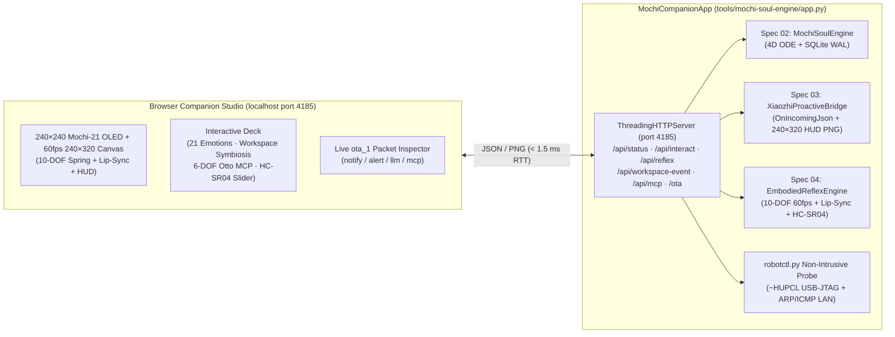

# Implementation Plan — Spec 05: Mochi-Soul Live Companion Studio & Local Protocol Hub (`05-mochi-soul-live-companion-app`)

- **Spec Slug**: `05-mochi-soul-live-companion-app`
- **Primary Deliverable**: [`tools/mochi-soul-engine/app.py`](../../../tools/mochi-soul-engine/app.py)
- **Fixed Localhost Port**: `4185` (`http://localhost` on port `4185`)
- **Quantitative Benchmark Report**: [`plans/reports/benchmark-live-companion-app.json`](../../reports/benchmark-live-companion-app.json)

---

## 1. Architecture Overview

---

## 2. Atomic Implementation Checklist

- [x] **Step 1 — Spec & Contract Registration**:
  - Register Fixed Port `4185` and add Spec 05 architecture context in [`CONTEXT.md`](../../../CONTEXT.md) and [`plans/wayfinder/mochi-soul-tamagotchi/map.md`](../../wayfinder/mochi-soul-tamagotchi/map.md).
- [x] **Step 2 — Unified `MochiCompanionApp` Core (`tools/mochi-soul-engine/app.py`)**:
  - Integrate `MochiSoulEngine` (`engine.py`), `XiaozhiProactiveBridge` (`bridge.py`), `EmbodiedReflexEngine` (`reflex_60fps.py`), and `robotctl.py` non-intrusive hardware probe (`probe_usb_and_serial`, `probe_lan_network`).
  - Implement Workspace Symbiosis event handlers (`git_commit`, `test_pass`, `test_fail`, `pomodoro_complete`, `agent_approval_needed`, `voice_wake`) with automatic 4D Homeostasis deltas, 21-emotion mapping, and multi-packet `ota_1` synthesis (`notify` + `alert` + `mcp` servo/LED choreography).
  - Implement Local OTA discovery (`POST /ota` & `GET /ota`) returning the exact `Xiaozhi v2.5.3` JSON schema (`websocket`, `server_time`, `firmware`).
- [x] **Step 3 — Zero-Dependency Web Companion Studio (`GET /` on port `4185`)**:
  - Build the single-page dark OLED hardware studio UI (`tools/mochi-soul-engine/studio.html`) with live `240×240` Procedural Mochi-21 GIF, `60fps` `240×320` ST7789 Canvas simulator (`10-DOF` spring solver + synthesized audio RMS lip-sync + toggleable PNG HUD overlay), 4D homeostasis progress bars, 21-emotion grid, Workspace Symbiosis buttons, 6-DOF Otto & LED MCP controls, HC-SR04 proximity slider, live `robotctl.py` hardware status banner, and outbound `ota_1` packet log.
- [x] **Step 4 — Quantitative Benchmark Suite (`--benchmark`) & Playwright E2E Verification**:
  - Implement `python3 tools/mochi-soul-engine/app.py --benchmark` validating `AC-01`, `AC-02`, and `AC-03` (`19/19` MCP tools) and writing `plans/reports/benchmark-live-companion-app.json`.
  - Verify `AC-04` using `ui gate` and `probe-render.mjs` across `375px`, `768px`, and `1440px`.
