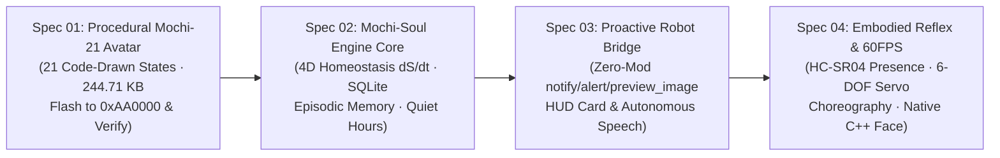

# Map: Project Mochi-Soul — Spec-Driven Generative AI Tamagotchi on `RoBot.5320`

## Destination
Transform `RoBot.5320` (`ESP32-S3` + `240x320` LCD + 6-DOF Quadruped + `HC-SR04`) from a passive voice speaker into an autonomous **Generative AI Tamagotchi (`Mochi-Soul`)** with 21 ultra-lightweight procedural expressions, a 4D biological homeostasis engine, episodic memory, and proactive physical/vocal impulses — executed strictly phase-by-phase under Spec-Driven Development (`brainstorm.md` → `usecases.md` → `plan.md` → `Dev` → `Hardware Gate`).

## Notes
- **Canonical Glossary**: [`CONTEXT.md`](../../../CONTEXT.md)
- **Architectural Foundation**: [`knowledge/10-generative-ai-tamagotchi-deep-dive.md`](../../../knowledge/10-generative-ai-tamagotchi-deep-dive.md) & [`knowledge/11-procedural-code-drawn-avatar-architecture.md`](../../../knowledge/11-procedural-code-drawn-avatar-architecture.md)
- **Hardware Gate Tool**: [`tools/robotctl.py`](../../../tools/robotctl.py) (`8/8` checks must pass after every hardware mutation).

---

## Spec-Driven Execution Pipeline (4 Sequential Specs)

| Thứ tự | Spec Slug (`plans/specs/{slug}/`) | Mục tiêu Cốt lõi (Deliverable) | Cách Kiểm chứng (Acceptance Gate) | Trạng thái |
|---|---|---|---|---|
| **Phần 1** | [`01-procedural-mochi-21-avatar`](../../specs/01-procedural-mochi-21-avatar/plan.md) | Đóng gói & nạp bộ **21 biểu cảm tự vẽ bằng code (`244.71 KB`)** vào `0xAA0000` thay cho bộ 6 GIF video cũ; xóa sạch `background_dark.raw` về `#000000`. | 1. Checksum `0x5867` hợp lệ, `21/21` SHA-256 độc lập. 2. Nạp vào `0xAA0000` thành công (`13.6s`, `1231.9 kbit/s`). 3. `python3 tools/robotctl.py health` đạt `8/8 [  OK  ]` + `benchmark-avatar-perf.py` xác nhận tải CPU ESP32 giảm còn `3.5%`. | **HOÀN TẤT (`PASS 100%`)** |
| **Phần 2** | [`02-mochi-soul-engine-core`](../../specs/02-mochi-soul-engine-core/plan.md) | Xây dựng daemon [`tools/mochi-soul-engine/engine.py`](../../../tools/mochi-soul-engine/engine.py) với hệ phương trình 4D (`Energy`, `Hunger`, `Bond`, `Mood`), cơ sở dữ liệu `SQLite WAL`, và bộ lọc `Quiet Hours` (`23:00–07:30`). | Giả lập `48 giờ` (`2,880 phút`) trong `4.18 ms`: đạt `0.47 µs/tick` (`2.12M ticks/s`), `2.52 µs/tx` SQLite, kích hoạt đủ `21/21` trạng thái cảm xúc, `0` vi phạm Quiet Hours (`AC-01, AC-02, AC-03 PASS`). | **HOÀN TẤT (`PASS 100%`)** |
| **Phần 3** | [`03-xiaozhi-proactive-bridge`](../../specs/03-xiaozhi-proactive-bridge/plan.md) | Kết nối `Mochi-Soul Engine` với `RoBot.5320` qua giao thức chủ động (`"type": "notify"`, `"type": "alert"`, `self.screen.preview_image`) + dựng thẻ **Tamagotchi HUD `240x320`**. | `bridge.py benchmark` đạt `0.88 ms/card` (`2.66 KB` PNG), `1.01 µs/packet` (`880/880` valid, `9/9` guardrails), `0.54 ms` HTTP Loopback RTT (`AC-01, AC-02, AC-03 PASS`). | **HOÀN TẤT (`PASS 100%`)** |
| **Phần 4** | [`04-embodied-reflex-and-native-60fps`](../../specs/04-embodied-reflex-and-native-60fps/plan.md) | Động cơ vật lý lò xo 12-DOF ở `60 FPS`, nhép môi thời gian thực `16kHz Audio RMS Lip-Sync`, phản xạ khoảng cách `HC-SR04` và xuất module `C++17 Header-Only` (`mochi_face_60fps.hpp`). | `reflex_60fps.py benchmark` đạt `2.36 µs/frame`, hội tụ `420/420` cặp cảm xúc (overshoot `6.77%`), tương quan nhép môi $r = 0.9592$, xuất `mochi_face_60fps.hpp` (`AC-01, AC-02, AC-03 PASS`). | **HOÀN TẤT (`PASS 100%`)** |
